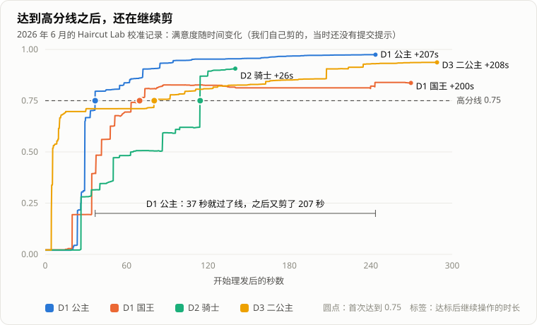

在《宫廷理发师》（HeirCut）里，玩家要真的拿剪刀给客人剪头发：鼠标划过的地方断开、掉落，剪完点「完成」，游戏拿剪出来的形状和目标形状比较，算出客人满不满意。怎么剪完全由玩家决定，分数不会显示出来。

几次线下展出，我们在展台边看到的是同一个画面：玩家明明已经剪得差不多了，还在一点一点修边，迟迟不点完成。问他们，答案都一样——**不知道要剪到多好才算满意**。

我们自己也是这样。下面是我们在实验场景里自己剪的四次记录：四次都过了高分线，其中三次过线之后又多剪了三分多钟。



这篇记录我们最后怎么设计「完成」按钮出现的时机、中间放弃了哪些做法，以及两个看起来是 UI 问题、其实是定义没想清楚的坑。

## 按钮要回答的，不是「剪得好不好」

先说清楚这个按钮要做什么、不能做什么。和策划讨论下来，目标是四条：

1. **告诉玩家「现在交是合理的」。** 让按钮的出现吻合玩家「差不多了」的预期。
2. **不泄露分数。** 理发的乐趣有一部分来自「我觉得我剪得不错」的不确定感。如果按钮一亮就意味着过线，玩家就会去刷那条线，而不是去剪头发。
3. **剪坏了能止损。** 不能因为玩家乱剪，就把人困在这一关。
4. **不鼓励犹豫。** 比划半天不下刀，也应该被推一把。

还有一个相关但独立的问题：评委老师普遍觉得理发失败的惩罚太重。当时的设计里蜡烛代表生命，剪不好就熄一支。不知道标准、失败代价又高，玩家自然不敢交卷。这个我们是在设计层面解决的：蜡烛改成了单纯的昼夜装饰，失败不再扣命。下面只讨论按钮。

## 最后的规则：五个出现理由

按钮在下面任何一种情况下出现，出现后就一直保持，直到玩家提交：

| 条件 | 玩家此时的状态 | 按钮想说的话 |
| --- | --- | --- |
| 满意度 ≥ 0.75 | 剪得不错 | 差不多可以交了 |
| 满意度 < 0.15 | 剪得一团糟 | 及时止损 |
| 比本次最高分回落 ≥ 0.1 | 本来不错，越修越差 | 别再修了 |
| 拿着剪刀累计 20 秒 | 一直在犹豫 | 不必追求完美 |
| 头发已经没有可剪的了 | 剪光了 | 只能交了 |

几点细节：

- **按钮出现后不自动提交，也不锁剪刀**，玩家仍然可以继续修，结算以点下按钮那一刻为准。按钮是建议，不是裁决。
- **20 秒只在玩家拿着剪刀时计时**，暂停菜单打开时不计。一开始我们是从「剪下第一刀」开始计时的，结果拿着剪刀比划半天不下刀的玩家——恰恰最需要被推一把的那种——永远等不到按钮。
- **这些数字没有理论来源**，是策划拍板后在试玩里调出来的。0.75 是结算的高分线，后面会讲为什么它必须和结算是同一个数。

规则本身写成一个不依赖场景的纯函数，方便单独测试：

```csharp
// 简化后的签名；实际代码还会先把输入夹到合法范围
public static HaircutSubmitPromptDecision Evaluate(
    bool hasValidSatisfaction, float current, float historicalPeak,
    float high, float low, float peakDrop, float operationSeconds, float fallbackSeconds)
{
    if (!hasValidSatisfaction)                 return Hide();
    if (current >= high)                       return Show(Reason.HighSatisfaction);
    if (current < low)                         return Show(Reason.VeryLowSatisfaction);
    if (historicalPeak - current >= peakDrop)  return Show(Reason.PeakDrop);
    if (operationSeconds >= fallbackSeconds)   return Show(Reason.FallbackDuration);
    return Hide();
}
```

### 为什么要故意放进和分数无关的理由

五条里只有第一条和「剪得好」有关。其余四条，有的意味着剪坏了，有的只是时间到了。

这是刻意的。玩家能感受到「按钮出现 = 现在交是个合理的选择」，但**没法从按钮反推自己剪得好不好**。对我们来说，这是让提示「有用但不泄底」最简单的办法。

## 我们试过、但放弃的做法

最终的规则不是一开始就想到的。前面还有几种做法，每一种都解决了一部分问题，又暴露出新的问题：


**一直显示。** 最早的按钮在进入理发时就出现，后来改成剪下第一缕头发时出现，之后一直都在。这是对自由度的尊重，但它只告诉玩家「你可以交了」，不告诉玩家「你应该交了」——展台上那些一直修边的玩家，就是这么来的。

**剪得够好时闪烁。** 后来加了一个提示：分数过线就让按钮闪一下。方向是对的，但它正好违反了「不泄露分数」：按钮一闪，玩家就知道自己过线了。而且它还有一个更隐蔽的毛病，见下一节。

**两道门槛。** 重写评分时，我在实验场景里跑过一轮校准，报告建议用双门槛：「剪对的比例 ≥ 0.80」**且**「形状吻合度 ≥ 0.90」，连续三刀都满足才算达标。最后没有采用，原因有两个：

- 硬性的「且」是不连续的。两项里差一点的那项会让结果从「是」直接跳到「否」。最后我们改用软最小值把两项合成一个连续的分数（细节见[下一篇]()）。
- 那轮校准的样本全是「剪得还不错」的记录，没有剪坏的，也没有犹豫的。拿这样的数据去校准一个以「止损」和「反犹豫」为目的的按钮，是不够的。

## 两个看起来是 UI、其实是定义的问题

### 「一刀」是什么

闪烁版本还有一个问题：它在**每次有头发掉落**时检查分数。

可是「掉一次头发」不等于「剪一刀」。一笔划下去，可能掉三片碎发，也可能一片都不掉，只划开了一个口子。于是提示的节奏跟着物理碎片走，而不是跟着玩家的操作走。更糟的是，剪发是边拖边算的，碎片在一笔的中途就会掉下来，那一刻读到的分数只是个中间状态。

所以在设计任何反馈之前，我们先给「一刀」下了定义：

> **一次有效笔划** = 鼠标按下到抬起的一段连续输入，至少造成了一次头发的几何变化，并且所有几何计算都已完成。

然后把两类事件分开：「有一片碎发掉了」只留给物理和音效；「一次有效笔划结束了」才驱动分数、教程、计时和这个按钮。这样，满意度曲线的横轴就是「玩家剪了第几刀」，按钮看到的永远是一个已经剪完、不会再变的状态。

回头看，这件事应该在设计任何反馈之前就做：**先定义玩家「一次操作」的单位。** 反馈挂在错的单位上，节奏就会乱，数值也不可信。

### 按钮和结算必须是同一个分数

这一个是我的疏漏。

重写评分时，我把按钮接到了新算法上，却没有同步去改结算——结算还在用旧的 IoU。两边的高分线也不一样：新算法这边写的是 0.80，结算那边是 0.75。于是有一段时间，游戏里同时存在两个分数。

后果是：按钮说剪得不错，结算却可能判不及格；或者明明已经过了结算线，按钮却毫无表示。玩家感受到的就是「这个按钮在骗我」。

发现之后分两步补上：先让按钮的阈值直接引用结算的阈值，并加了一条测试，以后谁把它们改得不一样，测试就会变红；随后结算也换成新算法，按钮和结算调用**同一个**判定函数。

这件事让我记住了一条：**一个 UI 如果是在预告某个判定的结果，它就该直接调用那个判定，而不是另写一份「差不多」的逻辑。** 两份逻辑一开始可能一样，但会各自演化，迟早分叉。

## 还没解决的

- **按钮规则缺少数据支撑。** 实验场景复用了正式的剪发和评分，但没有挂上这个按钮，所以我们手里没有「按钮何时出现、玩家何时提交」的统计。规则的调整靠的是试玩观察。
- **数字是调出来的，样本不大。** 如果之后有更大规模的试玩，最值得验证的是 20 秒兜底会不会让玩家过早交卷。如果会，应该调整时长或提示的措辞，而不是降低结算标准——兜底是为了反犹豫，不是为了放水。

## 回头看

这个按钮前后改了好几版，回头看，真正花时间的地方都不在按钮本身：

- **「一刀」没定义清楚之前，按钮怎么设计都不稳。** 我们一开始把反馈挂在物理碎片上，节奏和数值都跟着出问题。
- **预告判定的 UI 必须调用判定本身。** 按钮和结算各算各的分数，是我重写评分时漏改留下的，花了两轮才补上。
- **按钮出现的理由不止一个，这是它不泄底的关键。** 只在高分时出现的按钮，就是一盏及格指示灯。
- **兜底是为了反犹豫，不是为了放水。** 它让玩家可以交卷，但不改变结算标准。

---

**关于《宫廷理发师》**（HeirCut）：人类公主和兽人王大婚在即，玩家是宫廷里的理发师，要给前来的宾客们剪、烫、染。而在理发之外，理发师还能把宾客们说过的话「剪」下来、重新拼起来，改写公主乃至整个王国的命运。[Steam 商店页](https://store.steampowered.com/app/4268650/)，[演示视频](https://www.bilibili.com/video/BV1dkbDzoE9q/)。

开发团队「闭嘴！理发」是为 GameJam 凑起来的：策划尽欢、陈2333，美术 Nya、主美勺，音效肉丸，程序是我（hushh）。项目获得了第五届 CUSGA 最佳剧情设计奖、第十七届厦门国际动漫节「金海豚奖」最佳学生游戏奖等奖项，目前在准备 Steam Demo。

下一篇讲上面反复提到的满意度怎么算，以及它依赖的东西：一套可以被剪开的 2D 头发。
