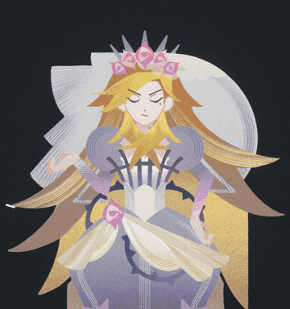
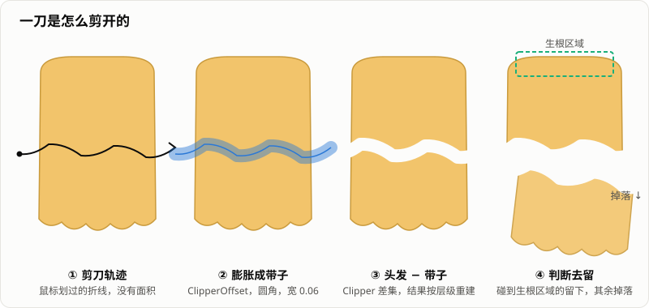
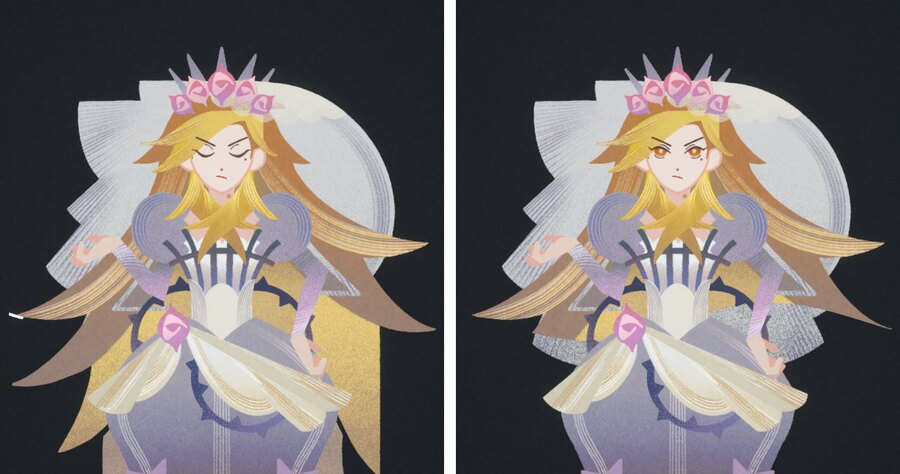
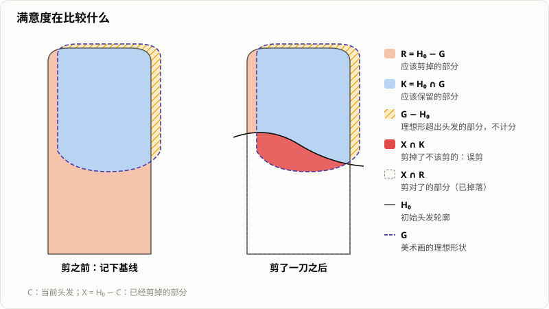

> 「HeirCut 开发手记」第二篇。游戏简介见[第一篇]()文末。

《宫廷理发师》里，玩家要拿剪刀给客人剪头发：沿着任意曲线、剪任意多刀，划过的地方断开，断下来的头发掉落，剩下的形状决定客人满不满意。



现在的做法可以用一句话概括：**每片头发是一个多边形，剪刀轨迹膨胀成一条带子，两者做布尔差集。** 这篇记录这套方案是怎么来的、具体怎么实现，以及为了手感踩过的坑。

## 头发是纸，不是发丝

最早的目标是《托卡美发沙龙》那样的拟真效果：头发是一根根有物理的发丝，剪断哪里，下半截就掉下来。我用 Verlet 积分模拟过发丝，但效果一直调不好——发丝多到看起来像头发，性能就扛不住；少到性能能接受，看起来就像几根面条。

转机来自美术方向。游戏最终定成了**纸片、立体书**的风格：角色像是用纸剪出来、立在舞台上的。头发因此不再是一束发丝，而是一张张纸片，剪头发也就变成了剪纸。

剪纸的第一反应是切 Sprite，但现成的方案大多只能沿一条直线切成两半。Unity 商店里有个插件演示效果不错，细看才发现曲线剪口也是用几条直线同时切出来的。理发需要的是任意曲线、任意多次，这两条路都不够。

最后的灵感来自 **2D 可破坏地形**：爆炸能在地面上挖出任意形状的坑，本质是多边形之间的布尔运算。把头发当成多边形，剪刀当成另一个多边形，问题就变成了一个成熟的几何问题。

这个方向定得很早，建库没几天，第一次提交的剪发就已经是这个方案了。后面的工作，基本都是在它上面打磨。

## 一刀是怎么剪开的



### 头发的表示

每片头发的几何真源是一份拓扑：若干块区域，每块有一条外轮廓，可能还带着几个洞。

```csharp
// 简化后的结构
public sealed class HairRegion   { public List<Vector2> outer; public List<List<Vector2>> holes; }
public sealed class HairTopology { public List<HairRegion> regions; }
```

碰撞体和渲染用的网格都从这份拓扑生成，评分和存档读的也是它。只有一份几何真相，就不会出现「看到的形状」和「算分的形状」对不上。

之所以要支持多块和洞，是因为一刀可以把一片头发剪成好几块，也可以在中间剪出一个窟窿。早期只存一条轮廓，剪出洞之后，洞会被当成实心的。

### 轨迹膨胀成带子

几何运算用的是 [Clipper2](https://github.com/AngusJohnson/Clipper2)。鼠标轨迹是一条没有面积的折线，没法直接和多边形做差集，所以先把它向两侧膨胀成一条带子：

```csharp
var offset = new ClipperOffset();
offset.AddPath(path, JoinType.Round, EndType.Round);   // 转角和两端都用圆角
offset.Execute(width * Scale * 0.5, ribbon);           // Clipper 用整数坐标，Scale = 1000
```

第一版不是这样做的：它在每两个采样点之间各自生成一个细长矩形，再拼成剪口。矩形和矩形之间没有衔接，转角处就会出现缺口和锯齿。换成带圆角的整体偏移之后，剪口才是一条连续光滑的曲线。

### 头发减去带子

差集的结果是一棵树：外轮廓下面挂着洞，洞里面还可能有岛。按树的层级把结果重建成区域和洞，一刀剪成好几块、剪出窟窿，都不需要额外处理。

### 哪些留下，哪些掉落

剪完之后，每片头发可能变成好几块，需要判断哪些还长在头上。每片头发顶部有一个矩形，标记「头发从哪里长出来」：和它相交的块留下，其余的掉落。

这个矩形的含义我们来回改过一次。第一版它就是这样的锚点；没过多久，它被改成了**保护区**——剪刀碰到根部，这一刀就作废，后来又改成只扣掉落在根部的那一段。保护区用了一年多，问题一直在：玩家想剪光的时候，头顶总会剩下一小块。

最后把它改回了锚点。改之前量了一下才发现，这个矩形本来就没有按发际线的精度画：如果把它的上边当作发际线，有的刘海、胡子只有 0% 和 7% 真正压在头发上。拿一个粗略的标记去做「保护」，本身就是误用。



### 碎片怎么掉

每一刀最多三片碎片做成真正的刚体，其余合并成一个只有视觉效果的网格，碎片总数由一个 32 个的对象池兜底，剪得再碎物理也不会爆炸。碎片带着初速度、自转和阻尼落下：大块懒洋洋地歪倒，小片转得更快。重力不随大小变化，「有些头发在飘」的感觉靠自转和阻力来表达。

我们最初想要的其实是另一种效果：像真实理发那样，每剪一下掉一撮，头发边剪边变短。这个一直没做出来，现在是剪刀划过的地方整片断开、整片掉落。回头看，这反而很符合纸片的感觉——纸剪下来，本来就是一整片落下去的。

## 从多边形到画面

拓扑变了，网格就要重建。第一版用的是扇形三角化，只对凸多边形正确，而头发的轮廓几乎都是凹的，很快就换成了 Poly2Tri 的约束三角化，洞作为约束一起传进去。

三角化偶尔会失败：洞的顶点恰好落在外轮廓的边上时，Poly2Tri 会抛异常。早期这会让整批切割回滚，玩家看到的就是「这一刀没剪断」。现在的做法是只在生成网格时把那个顶点挪开一个亚像素再试一次，权威拓扑本身不动。

网格的 UV 是从 Sprite 原图的坐标反推出来的。这带来一个隐性约束：**头发的 Sprite 不能打进图集**，否则拿到的是图集坐标。后来做图集优化时，这一条被专门写进了图集工具的注释里。

## 手感上踩过的坑

剪发能用之后，第一个大问题是**性能**，第二个才是锯齿。

第一版是松手才剪：一笔划完，一次性算。后来改成边拖边剪，为了省性能，输入每 0.2 秒才处理一次，被跳过的那一帧直接丢掉。代价是快速划过时，中间那段路径根本没被剪——玩家的感受是「剪刀有时候不灵」。后来的做法是把输入排成队列：采样点按距离入队，分批消费，每批先简化折线再一起剪，相邻两批的首尾稍微重叠，避免交界处留下一像素宽的「桥」。

**锯齿**主要取决于剪口的宽度：太窄，圆角不圆；太宽，又会剪到玩家没想剪的地方。最后定在 0.06 个单位。

还有一个查了很久的问题：**一次连续拖动里偶尔有一小段没剪断，位置随机，补一刀就好。** 原因是两道判断用了不同的门槛：判断「碰到了哪片头发」的面积门槛，比判断「这片头发剪得动」的门槛小了两百倍。一片只被擦了个边的头发会先被当成目标，切的时候又被判为「没切到」；而只要一批里有一个目标失败，整批都会回滚。公主、国王身上有好几处是多层头发叠在一起的，「一帧碰到多个目标」是常态，一次擦边就吞掉了那一帧真实的切割。修法是让两道判断问同一个问题，并把回滚的范围从「整帧」缩小到「叠在一起的那组头发」。

**洞**也经历过一次放开。一开始在头发中间剪出洞是被禁止的，代码会直接拒绝这一刀；后来补上了「挖洞之后建网格、存档再读回」的测试，把这个限制去掉了。

## 剪得好不好怎么算

### 不看轨迹，看结果

最开始策划的想法是：屏幕上画一条提示线，判断鼠标轨迹是不是落在线附近，那时的规则还是「一笔剪断」。我觉得不行：它评价的是「怎么剪」而不是「剪出了什么」，同样的结果，绕点路剪出来就不算；一旦允许多刀，轨迹判定也就无从谈起。

于是改成比较结果：美术为每片头发画一个理想形状 \(G\)，剪完之后算当前头发 \(C\) 和它的交并比：

$$
\mathrm{IoU}(C, G) = \frac{|C \cap G|}{|C \cup G|}
$$

IoU 能用，但我一直觉得它太简单：还没动剪刀，分数可能就有 0.6；它分不清「该剪的没剪」和「不该剪的剪了」，而对客人来说，「还长」和「剪秃了」完全是两回事；一片头发被剪成两块后，如果分别算再平均，权重也会变。

### 剪得对不对 × 形状像不像

现在的算法先按**原始头发**聚合：同一片头发剪出来的所有碎块先合并，再和基线比较，拆分就不再影响权重。

理发开始时记下基线。设 \(H_0\) 是初始头发，那么：

- 应该剪掉的部分：\(R = H_0 \setminus G\)
- 应该保留的部分：\(K = H_0 \cap G\)



设已经剪掉的部分为 \(X = H_0 \setminus C\)，第一项回答「剪得对不对」：

$$
\text{correctCut} = \frac{|X \cap R|}{|R|}, \quad
\text{wrongCut} = \frac{|X \cap K|}{|K|}, \quad
\text{cutScore} = \text{correctCut} \cdot (1 - \text{wrongCut})^{1.8}
$$

指数让误剪的惩罚比线性更重。

第二项回答「形状像不像」，比较的不是 \(G\)，而是 \(K\)——**玩家能剪出来的最好形状**。美术画的理想形状有时会超出初始头发，那部分无论如何都剪不出来，不该算到玩家头上：

$$
\text{shapeFit} = \frac{|C \cap K|}{|C \cup K|}
$$

两项用软最小值合成，\(\tau = 0.03\)：

$$
\text{satisfaction} = \min(a, b) - \tau \ln\frac{1 + e^{-|a-b|/\tau}}{2}
$$

两项相差很大时，结果就是较小的那项；两项接近时，比最小值再低一点点。效果是**两项都要好、主要看差的那一项**，而且是连续的，不会在某条门槛上突然跳变。

这个公式有个反直觉的地方：如果一片头发本来就要求剪掉 93%，那**把它剪光**，满意度不是 0，而是从 0.03 涨到 0.23——毕竟该剪的大部分都剪掉了。「剪光等于最低分」在这里不成立，调阈值时要记得。

为了调这些参数，我做了一个叫 Haircut Lab 的实验场景：复用正式的剪发和评分，记录每一刀之后的各项分数，导出后画曲线；误剪惩罚的指数也可以在 Lab 里用滑杆一边剪一边调。

## 剪过的头发要记住

客人下次出场时，发型要和上次剪完时一样。早期是把一条轮廓塞进 PlayerPrefs，既丢了洞和多块，同一片头发剪成的几块还会互相覆盖。现在整份拓扑存成一个 JSON 文档，带备份；WebGL 版存进 IndexedDB，两边格式相同。

## 卷发和染发

服务不只是剪短，还有卷发和染发。早期这两项做成了独立的小游戏：卷发是控制指示条追一个乱跑的目标，染发是给色块排序。原因很实在：当时没想到好的交互方式。

现在正在把它们都搬回头发上。卷发已经改成用烫发棒点击头发，在几档卷度之间切换——实现上不去变形几何，而是给每片头发准备好几档卷度的变体。染发在做涂抹原型：在头发上刷，用一张低分辨率的浓度网格记录每处染了多深，再按浓度混合原色和目标色，目前还停留在网页原型阶段。

## 还没解决的

- **生根区域还不是真正的发际线。** 改回锚点之后，「哪些留在头上」仍然由一个粗略的矩形决定。更合理的做法是为每片头发确定真正的发际线（自动推算或手工标注），方案已经写好，还没做。
- **边剪边变短没有实现。** 现在的效果和纸片风格是契合的，但如果以后要做更细的修剪手感，这仍是一个缺口。
- **头发不能打进图集**，做图集优化时只能把它们排除在外。
- **染发还没有接进游戏。**

## 回头看

- **选对表示，比选对算法更重要。** 发丝模拟怎么调都调不好；把头发看成纸之后，剩下的问题都是成熟的几何问题。
- **只保留一份几何真相。** 碰撞、渲染、评分、存档都从同一份拓扑派生，省掉了很多「看到的和算的不一样」的麻烦。
- **两个判据不一致，是我反复踩的同一种坑。** 剪发里是「算命中」和「算剪得动」，[上一篇]()里是「按钮的分数」和「结算的分数」。两处单独看都对，合在一起就错了。
- **很多「手感」问题，其实是数据问题。** 「剪刀不灵」不是剪刀的问题，是节流把路径丢了。

下一篇换个方向，讲剧情系统：一个为固定流程设计的状态机，怎么在换词机制面前一路膨胀，以及我们怎么在不停工的情况下把它换掉。
