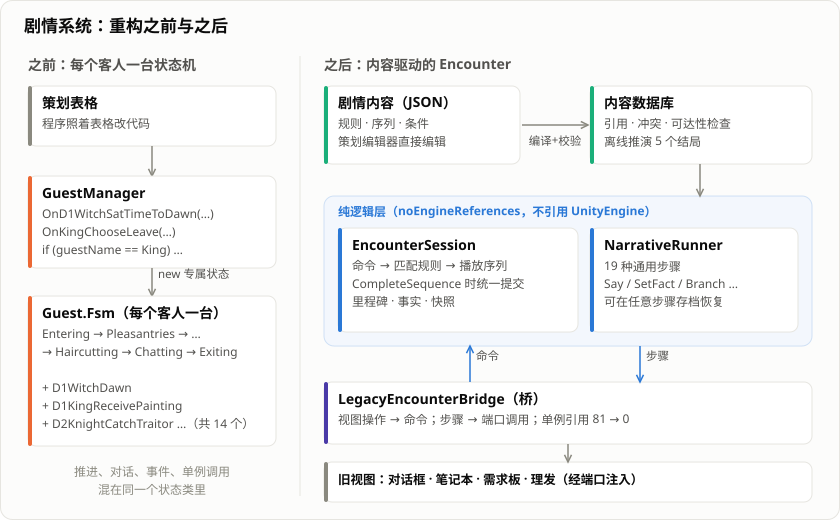
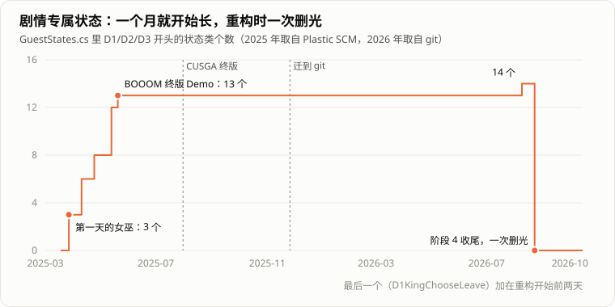
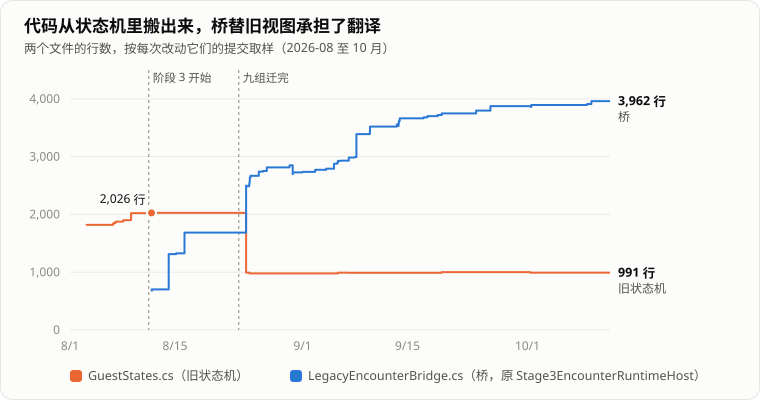

> 「HeirCut 开发手记」第三篇。游戏简介见[第一篇]()文末。

《宫廷理发师》的剧情靠换词推动：理发师把宾客说过的词「剪」下来，换进别人的句子里，对方就会做出不同的决定，后面几天来店里的客人和他们说的话也跟着改变。

这套剧情系统我写过两遍。第一版是每个客人身上挂一台状态机，写起来快，但在换词面前一路膨胀，最后谁也不敢动。第二版把剧情改成了数据，由一个不依赖 Unity 的纯逻辑层来推进。



这篇记录两件事：第一版为什么撑不住，以及我们怎么在游戏一直能玩的前提下，把它一点点换掉。

## 第一版：每个客人一台状态机

### 为什么选状态机

最初的设计里，每位客人的流程都是固定的一套：

> 进门 → 寒暄 → 分析需求 → 理发 → 满意 / 不满意 → 闲聊 → 离开

这几乎就是为状态机准备的。每位客人身上挂一台状态机，每个阶段一个状态类，一个状态做完自己的事，就切到下一个。在 GameJam 的节奏下，这样写又快又清楚，这个选择在当时没有错。

### 换词接不进去

问题出在换词。换词的效果是「在某句话里换了某个词，剧情就走向另一个分支」。它可能发生在流程的任何位置，可能改变后面的一切，而且每位客人、每个词的后果都不一样。

状态机里没有一个自然的位置来放它。最后的做法是：**每种换词结果，都接一个专属状态**。

```csharp
// 女巫的一次换词生效后，管理器收到一个专属事件，然后临时塞进一个专属状态
public void OnD1WitchSatTimeToDawn(D1WitchSetTimeToDawnEvent e)
{
    _currentGuest.Fsm.AddState(new D1WitchDawn(_currentGuest));
    _currentGuest.Fsm.SwitchState<D1WitchDawn>();
    _groupIndex++;
}
```

规则函数里也开始出现写死的角色和线索编号：

```csharp
// 女巫中午来卷发会烫焦头发，除非线索 4 或 5 被打过勾
return guestName == GuestName.Witch && !clue4Ticked && !clue5Ticked;
```

膨胀来得比我印象中早得多。翻早期的版本记录：状态机文件在建库第二周出现，一开始只有 8 个通用状态；**又过了一周多，接第一天的女巫时，就已经多出了 3 个剧情专属状态**。之后每接一组客人就长几个，不到三个月涨到 13 个，之后一年多没再变，最后一个加在重构开始的前两天。



其实那时就察觉到不对了。早期的提交记录里能看到几次挣扎：第二个月先后「搭多客人框架，为重构换词系统做准备」「重构客人系统」，第三个月又「准备重置换词功能」。但状态机这个骨架一直没动，专属状态还在继续增加。推倒重来的成本太大，而比赛有截止日期，只能将错就错。

### 它到底哪里不好

参展之后，我写了一份重构计划，第一节是诊断，归纳下来是四个根因：

1. **没有唯一的流程所有者。** 剧情分支、对话播放、UI 动画、异步加载都混在角色状态里。多人同时出场时，谁来推进剧情，取决于哪个角色的资源先加载完。
2. **剧情写在代码里。** 线索、道具、对话直接引用 C# 的状态类、事件类和数组下标。策划写好的剧情，必须由我翻译成代码才能生效。
3. **存档只能存到「第几天第几组客人」。** 一次会面进行到哪一步，没办法表达，读档就得从这组客人进门重来。
4. **资源没有稳定的标识。** 文件路径和文件名承担了运行时语义，改个名字就可能出问题。

最折磨人的是第二条。策划在表格里写好剧情，我照着表格改代码，每改一处都要翻好几个文件。

## 第二版：剧情是数据

### 一次会面，一个推进者

新架构的核心概念是**会面**（Encounter）：一组客人从进门到离开是一次会面，由一个会话对象作为**唯一**的推进者。会话的状态只有三样：

- **里程碑**：进门、等待对话、等待分析、准备理发、理发中、展示结果、理发后互动、等待离开、结束。所有客人共用这一副骨架。
- **事实**：剧情状态，比如「国王已经做出决定」。
- **正在播放的演出**，以及播到了第几步。

### 玩家的操作是命令，剧情的分支是规则

玩家的每个操作都被翻译成一条**命令**：推进对话、确认换词、递道具、点热点、提交分析、完成理发、摇铃，一共九种。命令进来后，会话在内容里找一条匹配的**规则**：当前在哪个里程碑、是什么命令、对着谁、在哪句话的哪个槽里换进了哪个词。匹配上了，就播放规则指定的那段演出。

以前「女巫换词后塞进一个专属状态」的写法，现在变成了内容里的一条规则。比如国王的一次换词（节选）：

```json
{
  "ruleId": "flow.d1.king.confirm_giver",
  "fromMilestone": "PostHaircutInteraction",
  "commandType": "ConfirmReplacement",
  "filterLineId": "line.d1.king.entry.010",
  "filterSlotId": "slot.king.intent",
  "conditionId": "condition.d1.king.giver_available",
  "sequenceId": "seq.d1.king.replace_first",
  "priority": 210,
  "factMutations": ["fact.d1.king.decision_ready=Boolean:true"]
}
```

读法是：在理发后的互动阶段，玩家对国王某句话里的某个槽确认了换词，并且条件满足，就播放 `replace_first` 这段演出，结束后记下「国王已经做出决定」。

演出由十几种通用步骤组成：说话、等待推进、换表情、移动角色、设置事实、给线索、开始理发、分支……没有一种是为某个角色写的。

有两条约定让这套东西比较牢靠：

- **同一优先级有两条规则同时匹配时，直接拒绝。** 这说明内容写错了，不应该让运行时去猜。导入内容时也会先检查一遍。
- **事实和里程碑只在一段演出结束时统一提交。** 演出播到一半存档、读档，看到的永远是「这段开始前」或「这段结束后」的状态，不会出现对话说了一半、剧情只改了一半。

### 不依赖 Unity 的好处

新架构里负责领域模型、内容和推进的几个程序集，都声明了不引用 UnityEngine。这个约束一开始像是自找麻烦，后来回报很大：

- 测试不用启动 Unity，直接用 `dotnet` 编译运行；
- 后来写的**离线推演器**能在纯逻辑层穷举整局游戏，检查五个结局是否都可达、有没有死路、哪些台词永远播不到；
- 策划编辑器里的「试玩」，用的也是同一份逻辑。

## 怎么在不停工的情况下换掉它

### 为什么不停下来重写

参赛之后我们决定继续做，也终于有了时间重构。但停下来重写不现实：这期间随时可能要出一个能玩的版本，给发行看，或者给玩家试玩。所以必须保证**任何时候游戏都能完整跑通**。

最后的做法是新旧两套并存，一组客人一组客人地迁移。新架构写成纯逻辑；旧架构继续跑还没迁移的客人；中间只有一座**桥**，把旧的视图和输入翻译成新架构的命令，再把新架构要播放的步骤翻译成对旧视图的调用。

桥一开始也是直接去拿各种单例的，最多时有 81 处。后来改成**端口**：桥只声明自己需要哪些能力（对话、需求板、笔记本、理发……），实现放在视图那一侧，由外面构造好交给桥。做完这一步，桥对旧单例的引用降到了 0。

### 先迁最难的三组

迁移按阶段推进：先以参展版为准，逐组客人记录每条路线该发生什么；再搭纯逻辑骨架和内容校验；然后才开始迁客人。

第一批没有挑最简单的，而是挑了覆盖面最广的三组：国王（一段换词同时提交两个槽）、公主（两次换词决定后面走剪发线还是卷发线）、下人和公爵（**两个人同时在场**）。最后一组是故意的：多人会面正是旧架构最混乱的地方——谁推进、谁说话、谁先离场——如果新架构在这里站不住，迁完单人客人也没有意义。

这三组的实机缺陷四天就清零了，再过一周多，剩下六组也迁完。14 个剧情专属状态一次删掉，状态机文件从两千多行降到一千行左右。

### 怎么确认「行为没变」

重构最怕的是悄悄改变了行为。我们靠的是几层东西：

- **基线**：迁移前逐组记录了参展版的行为，迁完一组就对照一组。
- **按名字比对回归结果**：项目里有一批重构前就存在的已知失败，判据不是「有没有红的」，而是「红的是不是正好那些」。只看失败数量，会漏掉「多了一个新失败、同时修好了一个旧失败」的情况。
- **缺陷表**：迁移过程中记了大约一百个缺陷，每个都有根因和修法。
- 后来又加上了离线推演器，以及一个在真实场景里从新游戏一路玩到结局的机器人。

自动化测试也从三百多项涨到了七百多项。

## 迁移中记住的几件事

**缺内容时不能悄悄退回旧路径。** 有一组客人，玩家把报纸交给平民之后，报纸被收走了，却没有任何对话。查下来是内容里少了一行排程，这组客人根本没被交给新架构；而代码在找不到排程时会悄悄退回旧状态机，旧路径里接收道具后的对话早就注释掉了。所有检查都是绿的。迁移收尾时，我们删掉了「新架构可以不接管」的开关，缺内容就直接报错。

**能记录的，就不要推断。** 读档时镜头该在中景还是近景，最初是从「是不是国王、在哪个里程碑、正在播哪段演出」推出来的，靠两张手写名单加一个国王专属分支。名单早就和内容对不上了，而且玩家点镜子切换视角是纯视图层的操作，领域层根本看不到，怎么推都推不出来。最后把镜头直接写进了存档。

**回退之前先证明因果。** 有一次给公主的一条规则加了过滤条件，三个测试变红，看上去像是新规则抢走了匹配，我就回退了。可是回退之后再跑，失败的还是那三个测试，一字不差——真正的原因是同一批改动里的另一处。两次运行的失败名单，本来可以立刻证伪那个猜测。

**计划会被测量推翻。** 原计划要把桥里的端口实现挪出去，动手前一量，发现大部分单例引用根本不在端口实现里，照计划做完也降不了多少，于是改成了上面说的端口装配。同一时期，「把四万多行的主场景拆开」那部分被搁置了：只能手工拆、只能实机验证，投入产出比太低。

## 现在的样子

最直观的变化是**维护成本降下来了**。以前加一段剧情分支，要新建状态类、注册事件、写处理函数、再加角色判断；现在大部分情况下只需要在内容里写规则和演出。

更大的收益在内容生产上。剧情先从「策划写表格、我照着改代码」变成了「表格直接编译成数据库」，后来又换成一组 JSON 文件，并有了**策划编辑器**：策划可以自己编辑剧情、看流程图、在编辑器里试玩，然后导出内容包交给我导入。以前每一处剧情改动都要经过我，现在不用了。

### 还没做完的



状态机变小了，但复杂度并没有凭空消失：

- **桥越来越大。** 它承担了把新架构翻译给所有旧视图的工作，后来的一些功能（比如按住快进对话）也加在了它身上。按计划，它要等旧视图都换掉之后才能删。
- **旧状态机还有一个外壳。** 14 个通用状态负责角色入场、离场这类表现，但已经不能再作为剧情入口。
- **主场景依然是一个超级场景**，拆分搁置了。
- 「当前是第几组客人」这个推进状态，还留在旧的管理器里。

## 回头看

- **第一版的状态机不是错的选择。** 它对固定流程很合适，错在换词让流程不再固定之后，我们还在往里塞。
- **流程要有唯一的所有者。** 谁推进剧情，必须是一个明确的对象，而不是取决于谁先加载完。
- **剧情一旦变成数据，就可以被校验、被穷举、被策划直接编辑。** 这是这次重构最大的回报，也是策划编辑器能做出来的前提。
- **边跑边换是可行的，但离不开一座桥和一份基线。** 桥让新旧两套能共存，基线让「行为没变」有了具体的含义。代价是桥本身会长成新的遗留，这笔账还没还完。

后半程的很多工作是和 AI 编程助手一起完成的，这部分我打算单独写一篇。
