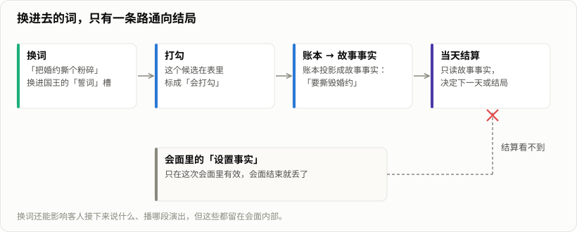

> 「HeirCut 开发手记」第四篇。游戏简介见[第一篇]()文末。

《宫廷理发师》的点子，是主策划在理发的时候想到的：理发师总爱和客人聊这聊那。那如果理发师能把客人说过的话「剪」下来，再拼进别人的话里呢？

这就是游戏的核心玩法——换词。客人说话时，有些词可以用剪刀剪下来，收进笔记本；有些句子里留着一个可以替换的位置，把笔记本里的词拖进去，说话的人就会顺着新的意思说下去，剧情也跟着改变。

这篇记录换词是怎么实现的、换进去的词怎么一路影响到结局，以及设计上我们一直在纠结的取舍。

## 一个例子

第一天的女巫来烫发。她说：

> 只有湿冷的环境，头发才不容易烫伤。可惜，现在是**正午**。

「正午」是一个可以替换的位置。如果玩家把之前从公主那里剪下来的「晚上」换进去，女巫会说「你真走运，夜晚是最佳的烫发时机」，烫发就不会把她的头发烫焦；如果换进去的是别的词，她会说「抱歉，我刚刚似乎失言了，请忘掉吧」，一切照旧。

整套机制就是这个循环的重复：**听 → 剪 → 换 → 看它变成现实。**

## 一句话是一串小块

### 富文本不够用

最开始考虑过直接用 TextMeshPro 的富文本：给可剪的词加个标签、上个颜色。但我们要的不只是「显示得不一样」：每个词要能单独点击、能被剪走、剪走后留下一个同样宽度的空位、空位要能接住拖进来的词，换进去的词长短不同还要重新排版。

富文本做不到这些，于是改成了**把一句话拆成一串小块**：普通文字是一块，每个可剪的词是一块独立的可交互对象，它们放在一个会自动换行的布局里，看起来就像一句完整的话。

建库第一周的版本就是这样做的。台词里用标签标出可剪的词，大致是这样（示意）：

```text
今晚是公主的大婚，为我<demand type="Curl">烫</demand>一个属于<clue id="…">巫女</clue>教母的发型。
```

解析器把它拆成「文字块 + 词块」，词被剪掉时，原位置换成一个等宽的空槽：

```csharp
// 第一版：剪下一个词，原位置换成同样宽度的空槽
public void CutKeyword(Keyword keyword)
{
    ClueBook.Instance.AddClue(keyword.ClueID, keyword.Text, keyword.transform.position);
    var slot = Instantiate(slotPrefab, dialogContainer);
    slot.transform.SetSiblingIndex(keyword.transform.GetSiblingIndex());
    slot.GetComponent<LayoutElement>().preferredWidth = keyword.GetComponent<LayoutElement>().preferredWidth;
    Destroy(keyword.gameObject);
}
```

「把话剪下来」这个比喻，从第一版代码就在了——它和理发用的是同一把剪刀。

### 现在的写法

后来剧情改成由内容驱动（见[第三篇]()），台词里不再直接写数字 ID，而是用占位符引用有名字的槽和词：

```json
{
  "text": "我能做的，也仅仅是在婚礼上{slot.king.vow}……然后告诉百姓，{slot.king.peace}。",
  "tokens": [
    { "tokenType": "ReplacementSlot", "slotId": "slot.king.vow",   "defaultTextKey": "text.token.king.vow.default" },
    { "tokenType": "ReplacementSlot", "slotId": "slot.king.peace", "defaultTextKey": "text.token.king.peace.default" }
  ]
}
```

运行时再把它翻译回旧的标签格式，交给原来的解析和显示代码。显示层基本没动，换掉的只是「词从哪里来」。

## 换进去的词，怎么改变剧情

### 每个槽有一张候选表

每个槽在内容里登记了一组**候选词**。比如国王上面那句话的两个槽：

| 槽 | 默认 | 候选 |
| --- | --- | --- |
| 婚礼上要做的事 | 宣读誓词 | 离开；把婚约撕个粉碎 |
| 告诉百姓的话 | 这门婚约将带来和平 | 我对狗毛过敏 |

玩家确认之后，卷轴烧掉、重新长出一句换好的话；按下一句时，这次替换才真正提交，去匹配剧情规则。

- 两个槽同时换成「把婚约撕个粉碎」和「我对狗毛过敏」，国王会走向「反抗」这条线，婚礼被推迟，第一天才能往下走。
- 只把第一个槽换成「离开」，国王会走另一条线；这个选择还会一直影响到第二天公主有没有出逃的念头。

### 只有一条路通向结局

换词能影响很多东西：客人接下来说什么、后面播哪段演出、这次会面怎么收尾。但真正能影响**结局**的，只有一条路：



一个词换进去，如果它在候选表里被标成「打勾」，就会记进笔记本的账本；账本被投影成一组**故事事实**；每天结束时，结算只读这些故事事实。

这个限制是被一次测试逼出来的。我们用编辑器加过一个测试用的第四天，在客人的会面里用「设置事实」记下「玩家是否起疑」。推演器显示所有规则都能触发，可两个结局里有一个怎么都到不了——因为会面里设置的事实，在会面结束后就没了，结算根本看不到它。改成由换词打勾来推导之后，立刻就通了。

还有一个后来才分清的概念：**「登记为候选」和「换进去会打勾」是两件事。** 一开始两者是绑在一起的，后来专门加了一个开关把它们拆开：有些候选是给将来的路线预留的，现在换进去不会改变任何东西。

## 设计上的取舍

### 自由度和工作量

我们希望玩家放下一个词的时候，是真心期待「它会怎么变成现实」。可每多一个能被接住的词，就要多写一段回应、多一条规则、多一次测试。

现在的内容里一共有 13 个槽、20 个候选词。换句话说，大部分槽只有一两个词会被「接住」。为了不让剩下的词显得无效，我们做了几件事：

- **错词也有回应。** 换进候选之外的词，客人会自己圆回去（「抱歉，我刚刚似乎失言了」），剧情照常继续，而不是直接拒绝玩家的操作。
- **有些槽只是为了参与感。** 国王问「这是……{谁}给你的？」，这个槽不影响路线，也不影响后面的对话，只是让玩家在关键时刻有手可动。
- **错词不能把客人卡住。** 如果换进去的词没有任何规则接住，客人就会停在那里。所以每句带槽的话都要留一个「默认往下走」的出口；编辑器里的换词向导会自动把它补上。

### 「正确的词」和「好玩的词」

更难的是另一个问题：我们到底希望玩家多换词、多试，还是只有换对了才算「正确」？

如果只有一个正确答案，换词就变成了填空题，会有点无趣。我们的做法是特意放进一些天马行空的候选——「我对狗毛过敏」「开门见山」——让玩家在荒诞里找到乐趣。这种荒诞感是我们想要的，但也是最难想到的。用策划陈2333 的话说：这主要靠对脑电波。

这个问题到现在也没有完全解决。

### 需求词：另一种收集

除了线索词，客人话里还有**需求词**，它们决定这次理发要做什么。需求词和线索词一样是剪下来的，但用法不同：玩家要把两个需求词放进合成板，合成出一个服务。比如国王的「手握王权」加「俯视众生」，合成「鹰翼」，这是对的；换成「手握王权」加「盘旋」，合成的是「蛇纹」，国王会不高兴。

需求词和合成板都是最初策划案里就有的循环，合成板长什么样是后来讨论出来的。实现上有一个容易被「修」坏的设计：**需求词属于玩家，不属于客人。**第三天的二公主要代替公主去联姻，她的需求就要用第一天从公主那里收来的词去合成。代码里查「有没有这个需求词」是跨角色的，这是故意的。

## 几个实现上的坑

- **拖到哪个槽，由词说了算。** 玩家拖词时瞄的是鼠标指针，但词是以指针为中心画出来的，两者对不上。后来改成「槽的中心落在被拖的词里面」，指针只用来打破平局；高亮和放下用的是同一个判断，免得高亮了一个槽，放下时却去了另一个。
- **挡住「跳过」的是状态，不是按钮。** 带槽的句子在换词完成前不能跳过。最早的做法是把「下一句」按钮藏起来，结果空格键和点击跳过照样能过。后来把这个判断挪到了推进对话的地方。
- **读档后需求词被算了两遍。** 一句话里有几个需求词没收集，就不让往下走。读档重新显示这句话时，已经收集过的词又被算回去了，而它已经点不动了，对话框就一直晃、游戏卡死。之前没出事，是因为玩家能重复收集同一个词，正好把计数凑平——**一个缺陷在掩盖另一个缺陷**，堵掉前者就暴露了后者。修法是让「显示成已收集」和「计数」共用同一个判断。
- **词拿出来再放回去，要回到原来那一页。** 笔记本按天、按客人分页。词被拖进槽、又撤回时，最初是按「当天 + 当前客人」算页的，结果跨天复用的词会回到一个根本不存在的页。现在是从哪一页拿的，就回哪一页。

## 还没解决的

- **「正确的词」和「好玩的词」之间的平衡**，还在调。
- **候选词是写死的。** 更多的候选意味着更多的手写回应。我们讨论过让 AI 来判断一个任意的词放进来「说不说得通」，并想好了边界：AI 只能在作者写好的几种结果里选，不能凭空创造剧情事实，超时就退回写好的文本，结果和存档一起保存，读档时不重新问。但这目前只停留在计划里。

## 回头看

- **一个词就是一个对象。** 放弃富文本、把句子拆成一串可交互的小块，是这套玩法能做下去的前提。
- **换词能影响的东西很多，但通向结局的只有一条路。** 这条限制一开始是踩坑踩出来的，后来反而成了内容作者最好理解的一条规则。
- **自由度要有兜底。** 错词有回应、没被接住的词不卡人、有些槽只为参与感——这些都是为了让「随便试试」不会被惩罚。
- **最难的部分不在代码里。** 想出「我对狗毛过敏」这样的词，比实现它难得多。
