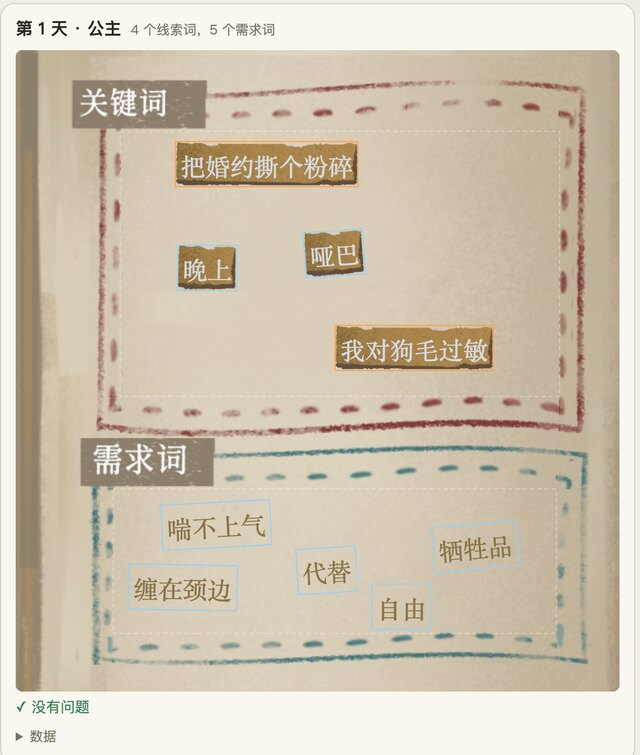

> 「HeirCut 开发手记」第五篇。游戏简介见[第一篇]()文末，换词玩法见[第四篇]()。

《宫廷理发师》里剪下来的词，会落进一本笔记本。笔记本按「天 + 客人」分页：游戏本来就是一天一天、一位客人一位客人往前推的，词和说出它的客人放在一起，玩家翻到那一页，就能想起「这是谁在什么时候说的」。

把词摆在纸上，听起来是最不需要讲的事。但它前后改了三版，每一版都是被一个具体的问题推着走的：

1. **手摆点位**：我在场景里一个个选位置；
2. **算法自动排**：内容开始由策划随时增删，点位跟不上了；
3. **美术定稿 + 规则兜底**：算出来的不够好看，要让美术能调，又不能让新词无处可放。

## 第一版：手摆点位

最早的做法很直接：我在笔记本里放了一组空物体当作位置点——线索区 12 个，需求区 9 个——每个词登记一个点位编号，显示时挂到对应的点上。

问题是：**点没有大小，词有大小。** 一个词框的宽度大约是「24 × 字数 + 10」，从一个字到七八个字都有。会不会出框，取决于「哪个词」放在「哪个点」，而 43 个线索词 × 12 个点的组合，没人逐一检查过。页面的边界也不在数据里——那几个容器本身只是 100 × 100 的空壳。

后来实测了一次，把每一天的词都收齐：线索区 11 页里有 12 个词越界、5 对重叠；需求区 8 页里有 10 个越界、1 对重叠。更糟的是，线索区 12 个点里有 3 个，连最窄的一个字的词放上去都会越界——它们根本不在纸上，「再调一调点位」是调不好的。

真正让这一版撑不下去的，是后来策划可以自己在编辑器里增删词了。新加的词没有点位，最初的处理只能是「报个警告、不显示」。

## 第二版：让算法来排

于是改成让每个词自己找位置。思路是：

- 每个词从**自己 ID 的哈希**出发，沿一个低差异序列在整页上试位置，第一个「不出框、和已经放下的词离得够远」的位置就落下；
- 先试满幅度的倾斜，空间紧张时再逐档扶正；
- 整个过程是确定的：同一页、同一组词，永远排出同样的结果。

它用构造保证了四件事，并且每一条都有测试：**不出框、不重叠（互相留 10 像素）、追加新词不移动老词、结果确定。**

这里最有意思的弯路是「排成行」。最初的版本是一行一行地放，再给每个词加一点随机抖动，想让它看起来像随手贴的。可无论怎么抖，读起来都像一行字——**共享的基线本身就会被读成一行**。把抖动预留出来，空页面也会处处收紧，最后只剩 ±3.4 像素和 1 度；改成放完再检查，又还是偏规整。最后干脆不排行了。

### 两个测量陷阱

这一版还踩了两个量尺寸的坑，它们的共同点是：**看起来在测量，其实量到的不是真东西。**

- **词框尺寸不能从图片的元数据推。** 词的背景图有四档，读它们的导入信息会得到 75、104、136、201 × 61 四种尺寸。可这些图在游戏里是被拉伸着用的，真实的词框是「24 × 字数 + 10」宽、44 高。从元数据推出来的数字和模型，两样都是错的。
- **要等界面排完版再量。** 词刚实例化出来的那一帧，量到的是预制体裸的 10 × 20。算法按这个尺寸摆，放进游戏里，8 个词有 3 个越界、4 个重叠。离线测试抓不到这个问题，因为测试是直接把尺寸传进去的。修法是先强制界面排一次版再量，并加了一道守卫：量到的尺寸小得不正常，就直接报错。

### 代价

算出来的布局解决了「出框」和「新词无处可放」，但两个代价也很明显：容量有限（一页线索区大约能放 17 个两字词，或 6 个七字词），而且**它是对的，但不一定好看**。哪里该疏一点、哪里可以挤一挤、长词旁边该不该多留空，这些都是审美判断，写死在算法的权重里谁都调不动。

## 第三版：美术定稿，规则兜底

第三版的思路是我提的：既然好不好看要美术说了算，那就**把规则做成一个工具交给美术，让美术调到满意，再把结果固定下来**；规则留在游戏里，只负责处理美术没见过的词。

### 规则

规则分两层。**硬规则**必须满足：词框在可放置区内、词与词之间留足最小间距、倾斜角度随字数减小（长词不倾斜）、放不下就报告而不是画出框、已经定下的位置不因为增删别的词而改变。**软目标**用来打分：长词之间多留空、疏密自适应、不贴页边、不排成行列、略微偏向中心、短词尽量倾斜。

算法对每个候选位置先用硬规则过滤，再按软目标打分取最好的；整页会重试若干次，取丢词最少的那一次。

### 美术的工具

美术拿到的是一个双击就能用的网页：左边调参数（间距、长词间距、倾斜、页边留白……），右边是用游戏真实素材画出来的每一页。可以生成几套方案并排对比，也可以勾选「手动摆放」直接拖动某个词。调满意了，下载一个方案文件交回来。

我这边把方案文件**烘焙**成一张位置表：每一页、每个词的位置和角度。烘焙时会再检查一遍硬规则，有违反就拒绝写入。

### 游戏里怎么用

游戏读这张表：**表里有的词，原样钉在美术定的位置；表里没有的词（策划后来新加的），由同一套规则围着已经钉住的词自动排开。** 如果页面的几何尺寸和烘焙时对不上（超过 1 个单位），说明界面改过了，整页退回规则排，并报一次警告。

内容里增删了词，跑一遍校验命令就知道表是否过期；过期就重新烘焙。

### 同一份算法，跑在两个地方

美术的工具是网页，游戏是 Unity。如果两边各写一份算法，美术看到的和游戏里排出来的迟早会不一样。

我的做法是：**C# 是唯一的真源**，游戏和命令行工具编译的是同一份源码；网页里的 JavaScript 版本逐句移植，并有一个对拍测试——用十几组参数、每一页，逐位比较两边的输出，任何一处不同就失败。测试写好后，我故意把 JS 里一个常数的第十位改掉，它当场就红了。

## 一个后来才发现的问题：取走一个词，其他词都动了

位置表接进游戏后，又冒出一个问题：把一个词从笔记本拖进槽里，这一页**剩下的词全都换了位置**。

原因在规则兜底那一层：没有烘焙条目的词由规则排，而规则的输入是「现在书里有哪些词」。取走一个，输入变了，结果自然也变了。这违反了第三版最根本的承诺——**一个词的位置，只取决于它在哪一页、它是哪个词。**

修法是把输入从「书里现在有的词」改成「这一页内容里所有能归档的词」：不在书里的词也参与排版，只是作为看不见的影子，排完就丢掉，只画出现有的。教程里那一页之前没传「当前页」，等于「没有这一页」，也一并修了。

## 还没解决的

- **有些页面的规则满足不了。** 需求区比较矮，按定稿的参数，有几页做不到规定的页边留白，词贴着边。这是看过之后接受的取舍，不是 bug。
- **有一个玩家拿不到的词仍然占着位置。** 它在内容里存在、在笔记本里留了空间，但当前路线里收集不到。这是内容层面的问题，还没处理。
- **换词之后字数变了，按哪个排**，以及参数文件改了要不要算作内容版本的变化，都还没定。

## 回头看

- **每一版的推动力都来自「谁来改」。** 我一个人维护时手摆点位够用；策划能自己加词时，就必须由规则来排；要好看时，就必须让美术能调。布局方式，最后其实是在回答「这件事归谁管」。
- **「对」和「好看」要分开交给不同的东西。** 硬规则保证对，美术保证好看，规则只为美术没见过的情况兜底。
- **量尺寸之前，先确认量的是不是真东西。** 拉伸过的图片、还没排版的界面，都会给出一个看起来合理的错数字。
- **一个承诺要落实到输入上。** 「位置只取决于页和词」这句话写在文档里是不够的，规则的输入里只要混进了「现在书里有什么」，承诺就会被打破。
