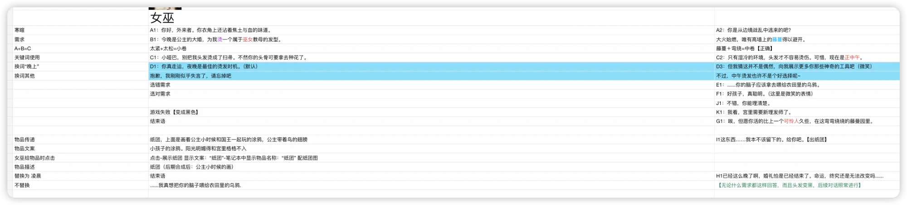
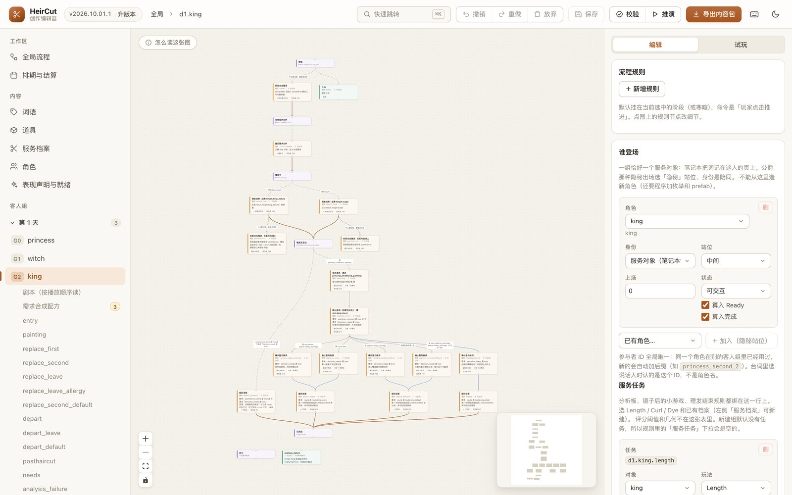
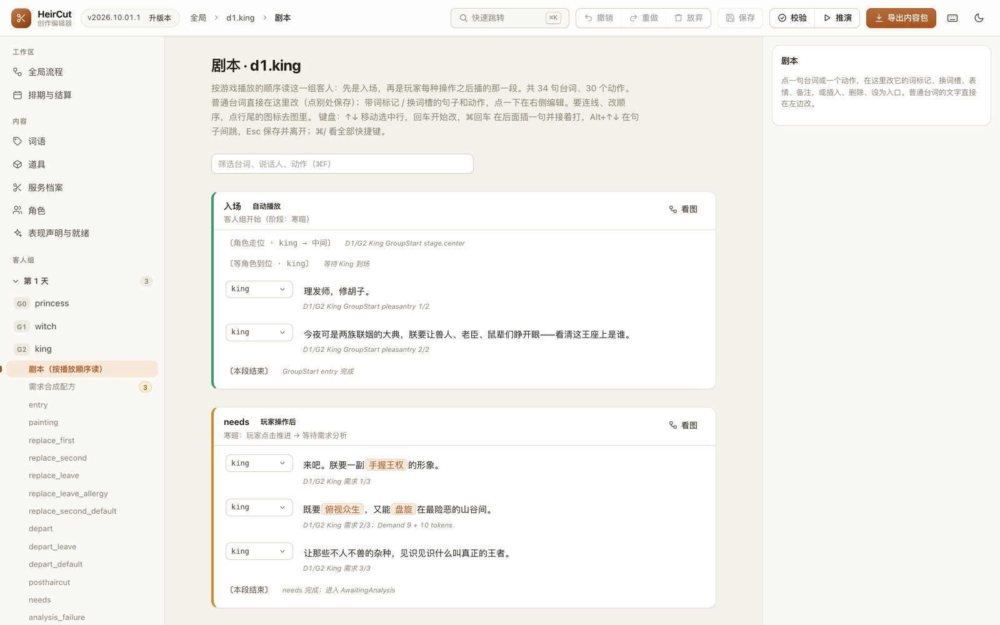

> 「HeirCut 开发手记」第六篇。游戏简介见[第一篇]()文末。

《宫廷理发师》的剧情，最早是这样交到我手上的：

每位客人一列，每个环节一行：寒暄说什么、需求是什么、哪两个需求词合成什么、换了哪个词会说什么、选错了怎么回应、递什么道具……我照着表格，把台词一句句敲进 Unity 里的配置资源，再把线索词表、需求词表对上编号。剧情每更新一次，这些都要重来一遍，对没对上全靠肉眼。

这篇记录这件事是怎么一步步变成「策划自己改、自己试、导出一个包给我」的。

## 问题不只是「麻烦」

照着表格改，表面上的问题是慢。真正的问题在后面：

- **内容和代码绑在一起。** 一个线索的配置里同时写着它是谁、能换进哪个槽、换进去触发哪个代码事件、在笔记本的哪个点位显示。改一处，要翻好几个地方。
- **编号就是数组下标。** 线索用整数编号，同时也是一个长度 60 的数组的下标。删一个、插一个，后面全乱。
- **错了也不知道。** 表格写错一个词、配置漏一行，要到实机玩到那里才会发现，有时候还发现不了。

第一步是在[重构剧情系统]()的同时，给所有内容换上**稳定的名字**（比如 `clue.princess.garden`、`line.d1.king.entry.010`），名字一旦创建就不再改、删掉的不再复用；然后搭一条管线：内容先经过导入和校验，再生成游戏实际读取的数据库。

## 第一条管线：仓库里的表格

一开始选择的真源是放在仓库里的 Excel 工作簿：策划熟悉表格，管线只要读表就行。

管线是这样的：读工作簿 → 导入成内容模型 → 跑一遍校验 → 生成游戏读的数据库资产。校验现在一共有 103 种诊断，比如「同一个名字被两种东西用了」「演出里引用了不存在的台词」「某个客人组从来没被排进任何一天」「同一个时机有两条规则冲突」「同一个槽、同一个词登记了两遍」。很多以前要玩到才发现的错，在导入时就被拦下了。

但表格本身很快成了瓶颈。演出的步骤表有九百多行，而下拉校验只设到了第 500 行；说话人和表情没有下拉；工作簿里的说明早就过时了。更根本的问题，是后来做编辑器时才看清的。

## 从表格换成 JSON

### 真正的问题：表格只能写「已经实现的东西」

计划做编辑器时，我发现一个绕不过去的问题：内容表里同时装着两种东西——**创作意图**（谁说了什么、换了词会怎样）和**实现绑定**（用哪个表情、哪个动作、哪张图）。于是编辑器只能让策划选「已经实现了的东西」：想让一个新角色说话，得先有这个角色的美术；想写一个新表情，得先有这张脸。

所以内容被拆成了三层：

- **创作层**：策划维护，随时可以新增；
- **绑定层**：程序和美术维护，等素材到了再补；
- **就绪报告**：工具自动生成，告诉大家哪些内容还缺素材、缺程序支持。

还没实现的东西，游戏运行时用占位代替，不会因为缺一张图就跑不起来。

### 换真源，但下游一行不改

创作层换成了一组 JSON 文件：一个项目文件（天的顺序、内容版本），每个客人组一个文件（参与者、台词、规则、演出），每天一个文件，再加几份共享的目录（角色、线索、需求词、道具）。每一行内容都恰好属于一个文件，格式化工具会按规则把它放回该在的位置，策划手改也不会乱。

我给它写了一个编译器，**输出和原来的工作簿读出来的东西一模一样**。这样只需要换掉读取的入口，导入之后的校验、运行时和存档都不用改。

切换的判据也很明确：把工作簿反编译成 JSON 再编译回来，和直接读工作簿的结果逐表、逐行、逐列相等。切换那天，迁移生成的 21 个文件和原工作簿逐格比对是 0 差异，两份工作簿随后被删除。

## 编辑器

编辑器是一个本地网页（React + React Flow），策划在自己的电脑上打开。它能做的事大致是：

- **看全局**：几天、几组客人、每天怎么结算，结算条件可以直接选「故事事实」；
- **改一个客人组**：流程图里节点是演出、边是规则；也可以切到**剧本视图**，按游戏播放的顺序把一组客人读成一份剧本，直接在行内改台词；

  

- **管词**：线索词、需求词、需求合成配方、道具、理发服务；
- **用向导**：理发通路向导一次生成「分析需求 → 理发 → 成功 / 失败 → 离场」的整套规则；换词分支向导一次建好槽、候选词、每个候选的回应，以及「换了别的词」时的兜底出口；
- **用替身**：新角色还没有美术时，可以先借一个现有角色的形象写剧情，美术到了再换回来，剧情不用动；
- **试玩**：在编辑器里直接玩一组客人。后端和游戏用的是同一套会话逻辑，所以「编辑器里能玩到」和「游戏里能玩到」是同一件事；只是理发和点热点用按钮代替。

保存时会自动格式化；一键可以跑校验，也可以跑**推演**——在纯逻辑层把整局游戏穷举一遍，看五个结局是否都能到达、哪些台词永远播不到。

### 交付：一个包，一次导入

策划用的是一个精简过的仓库副本（只有剧情、编辑器和工具，八十兆左右），不需要装 Unity。改完后点「导出内容包」，得到一个文件，里面带着每个文件的校验和、离线检查的结果，以及这份内容依赖了哪些素材。

我在 Unity 里用菜单导入：先看预览（新增、修改、删除了什么，有没有版本倒退），确认后导入并重建。导入前后会备份，任何一步失败都整体回滚，备份只留最近两份。

这里有一个不起眼但很重要的限制：**内容变了，内容版本号就必须升。** 存档只比较版本号字符串。版本号没变而内容变了，旧的中途存档会被拿去恢复；如果存档指向的那一步已经被删掉，恢复就会失败，客人不入场。所以导出时，如果内容和上次导出的不一样、版本号却没变，编辑器会直接拒绝，提示先升版本。

## 三次「加一天」

编辑器做出来之后，我们用同一个场景反复测过它：**在现有三天之后，加一个第四天。** 每次都暴露了不同层面的问题。

**第一次：第二套真源。** 剧本写好了，校验、推演、自动化测试全部是绿的。进游戏，客人入场后卡了 10 秒，然后报错。原因是一份很早的配置资源，按「天 + 客人」存着需求板的候选词，它是和内容并行的第二套真源，没有第四天的行。所有离线检查都看不到它。修法是缺行时直接从内容合成。第一版修法读的是「正在进行的会话」，可那时会话还没建立——这个循环依赖也只有进游戏才暴露。

**第二次：从编辑器走一遍全流程。** 用编辑器新建一个第四天的女巫，从录入一路走到游戏里机器人跑到结局，全链路通过。途中补了一串缺口：结算条件选不到新加的故事事实、占位客人不会离场、没有新建演出的入口、推演面板不显示失败原因、没保存的改动刷新就丢……

**第三次：正式验收。** 四组客人的第四天，女巫烫发、平民染发、骑士剪发、下人送信，全部通过编辑器界面录入，没有直接写 JSON，新增 27 句台词。导入 Unity 重建后零错误，机器人跑完整条路线到达结局。

之后又做了一轮独立复测，不看前面的记录，从头再走一遍：主路径成立，16 个故意做坏的内容包全部被拒绝；同时发现了 5 个问题，比如导入预览不显示具体差异、每次导入留下一百多兆备份从不清理、导出不强制升版本。前两个随后修掉，第三个就是上面说的那道「先升版本」的拦截。

## 踩过的坑

- **离线全绿，不等于游戏里能跑。** 第二套真源、还没重建的生成库、测试里写死的资源清单，都会让离线检查全绿而游戏出错。每一次的形状都一样：检查验的不是真正被用的那份东西。
- **字体会漏字。** 游戏用的是静态字体图集，内容里出现了图集没有的字，不会报错，而是直接显示成空白。现在重建内容时会同步字符集、重烘图集，校验也会提示字符集过期。
- **整目录覆盖文件会静默丢改动。** 有一次把一个旧分支上的工作拆进新分支时，整目录取了文件，结果新分支在那之后的 250 行改动被悄悄覆盖了，所有检查都是绿的——被删掉的东西本来就没有测试覆盖。之后的规矩是：拆分完统计「新分支有、结果里却不见了」的行数，必须为零，或者每一行都能解释。

## 还没验证的

- **编辑器还没有经历过一次真正的剧情更新。** 上面的三次测试都是我们自己造的场景；编辑器上线之后，团队还没有过剧情改动。它在真实协作里好不好用，要等下一次更新才知道。
- **新表情、新动作、新的结局图**，编辑器现在只能「声明」，还不能直接用进台词，要等程序和美术补上绑定。
- **复杂的嵌套条件**，还得手改文件。

## 回头看

- **工具的边界，其实是责任的边界。** 表格时代所有东西都要经过我；拆成创作层和绑定层之后，策划管写什么，程序和美术管怎么实现，中间由就绪报告对账。
- **换真源，最好让下游感觉不到。** 编译器输出和原来一模一样，校验、运行时和存档都不用动，迁移才能做到「逐格比对零差异」这种可以验证的程度。
- **离线检查要知道自己验的是哪一份东西。** 三次加一天里最贵的问题，都出在离线检查看不到的地方。
- **一个编辑器好不好，最后要由用它的人来回答。** 这一题还没交卷。
