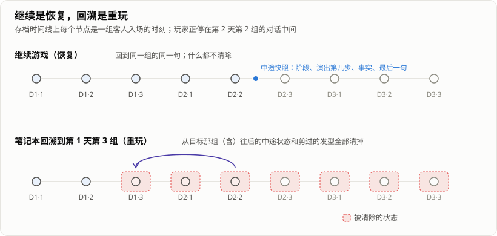

> 「HeirCut 开发手记」第七篇。游戏简介见[第一篇]()文末。

《宫廷理发师》里，一组客人从进门到离开可能要聊十几分钟：寒暄、分析需求、理发、换词、递道具。玩家在中间退出，再点「继续」，期望的是回到刚才那一句。

很长一段时间里，游戏做不到这一点，只能回到这组客人进门的那一刻。这篇记录存档是怎么从「回到这组客人的开头」变成「回到这一句」的，以及做这件事时，我们对「存档到底存什么」的几次重新理解。

## 最早：只存到「第几天」

最早的存档是我写的，粒度很粗：一开始只记得玩到了第几天，后来才一步步细化。那时也没有「存档文件」这个概念。笔记本、解锁的工具、蜡烛数、上次玩到哪一天、每位客人剪过的头发轮廓，各自往 PlayerPrefs 里写几个键；新游戏就把它们全部清空。没有版本号，也没有「一次存档」这个整体。

直到项目做了一年多，存档才整理成一份文档：原生平台写一个 JSON 文件（先写临时文件再替换，保留一份 `.bak`），网页版写进 IndexedDB。文档里是一条**时间线**，每个节点对应「第几天、第几组客人」：客人组入场时记下当时的笔记本、蜡烛、已解锁的工具、对话记录和发型。「继续」就是回到最后一个节点。

为什么不再细一点？不是不想，而是做不到：剧情跑在每个客人身上的状态机里，「一组客人进行到哪一步」散落在状态、协程和界面动画中，想存得更细，麻烦会成倍增加。能稳定存下来的，只有客人组入场这个干净的时刻。

这个粒度有一个明显的缺口：一组客人内部发生的事——聊到了哪一句、换过哪个词、理发结果是什么——都没有存下来。

## 想回到「这一句」，要存什么

在旧架构里，这个缺口补不上：一组客人进行到哪一步，是散在各个角色的状态机、协程和界面动画里的，没有一样东西能被完整地存下来。

[剧情系统重写]()之后，情况变了。一次会面的进度本来就是一份数据：当前在哪个里程碑、正在播哪段演出的第几步、记下了哪些事实、每位客人处在什么状态、理发结果、已经处理过的命令、最后显示的是哪一句。把这份数据序列化，就是会面的中途快照。

这里有两条原则，决定了快照能不能可靠地恢复：

- **存逻辑状态，不存表现。** 快照里没有协程、没有补间动画、没有动画播到第几帧。恢复时根据逻辑状态把画面重新摆出来。
- **只在干净的边界上改状态。** 剧情的事实和里程碑只在一段演出播完时统一提交。所以无论在哪一刻存档，快照里的状态都是「某段演出开始前」或「结束后」，不会是「台词说了一半、剧情只改了一半」。

除了会面本身，还有几样东西得跟着快照一起存：那一刻的笔记本、对话记录、镜头在中景还是近景、正在进行的教程。这些都还在旧的界面层里，会面的逻辑层看不到它们，但恢复时缺了任何一样，画面都对不上。

## 「继续」和「回溯」是两件相反的事

游戏里有两种「回到过去」。后一种是我们从最开始和策划一起定下的设计：笔记本相当于一次穿越，翻回某一天、某位客人那一页，就回到那个时刻重新来过——所以我们管它叫「回溯」。

- **继续游戏**：回到上次存档的地方，接着玩。
- **笔记本回溯 / 切换到某一天**：回到某一组客人的开头，重新玩。

它们看起来很像，处理方式却正好相反。**继续是恢复**，什么都不能丢；**回溯是重玩**，要把目标那一组以及之后所有的中途状态都清掉，连带那之后剪过的头发。

这两条路一度共用了一段「截断时间线」的逻辑，这也是存档里最严重的一个缺陷的来源：玩家点「继续」时，代码先按回溯的规则把当前这组之后的东西截掉——而中途快照当时存在一个单独的文件里，就这样被删了。结果「继续」变成了「从这组开头重来」。更荒唐的是反过来：玩家选「退出但不保存」，那个单独的文件却没被清，本该丢弃的进度反而留了下来。

修法有两步。一是把中途快照**并进主存档**，随主存档一次写盘，不再有「主档存了、快照没存」或反过来的中间状态；二是把两条路彻底分开，「清除中途状态」的那个函数在注释里写明：继续游戏绝不能调用它。

## 几个不显眼的坑

**JSON 序列化表达不了「没有」。** Unity 的 `JsonUtility` 无法把一个嵌套对象序列化成 null：写出去再读回来，它会变成一个默认构造的空对象。而存档每次提交都要克隆一遍，克隆就是一次 JSON 往返。于是「这组客人有没有中途状态」的判断永远是「有」，发型永远不会被截断，表现为恢复之后头发变回没剪过的样子。之后的约定是：**存档里的可选值一律用显式的布尔标记**，读取时只看标记。

**界面上暂时拿着的东西，不能算进存档。** 玩家把两个需求词放上合成板、还没合成时存档，这两个词既不在笔记本里，也不在任何会被保存的地方。读档后它们就凭空消失了，有时还会让这组客人再也推进不下去。现在写盘前会先把合成板、道具合成台上的东西还回笔记本。

**恢复一个已经结束的会面。** 如果存档时这组客人已经聊完，恢复时会重建一个没有规则可走、没有台词可播的会话，客人就站在那里不动。现在遇到已完成的会面，直接走完成流程。

**失败的理发播到一半。** 理发失败后有一段失败的演出。在它播到一半时存档，恢复必定失败：恢复代码要求待提交的理发结果是「完成」，而失败规则给出的是「失败」。这个缺陷不是人发现的，是编辑器试玩后端的一个随机自测——随机玩几百局，每局在随机位置存档再恢复，对比恢复前后看到的东西是否一致——撞出来的。修好之后，又在游戏里让机器人专门在那段演出中途存档退出，确认修复前失败、修复后能一路玩到结局。

**版本号是一道硬闸。** 主存档的结构版本要求严格相等，升一次版本，玩家现有的存档就全部作废。这在发布前是可以接受的，所以每次升版本都必须在一个地方显式改，不能顺手。剧情内容另有一个内容版本：存档只比较版本号字符串，内容改了而版本号没升，旧的中途快照会被拿去恢复——指向的步骤还在就带着新文字恢复，不在了就失败。这也是为什么[策划编辑器]()在内容变了、版本号没变时会拒绝导出。

## 怎么确认它真的能恢复

存档的问题很难靠单元测试兜住，因为它涉及的是「整个游戏在某一刻的样子」。我们靠的是[实机机器人]()的两组验收：

- **存档继续**：对九组客人，每组在进行中打开菜单、存档退出、再点继续，核对是不是同一位客人、同一个阶段、同一句台词。
- **回溯**：在不同的天和客人组上用笔记本回溯，包括跨天回溯，确认重玩的进度和第一次一致。

回溯那组顺带发现了一个设计层面的问题：回溯重玩时，第一次分析需求的教程会再出现一遍，又把词锁住一次。

## 还没解决的

- **没有存档迁移。** 每次升存档版本都直接作废旧档。上线之后就不能再这样了，到时候需要真正的迁移。
- **网页版没有备份回落。** 原生平台读主文件失败时会读 `.bak`，网页版的 IndexedDB 只有一份。

## 回头看

- **能不能恢复，取决于状态是不是数据。** 存档的能力不是存档代码给的，是剧情系统重写之后，「进行到哪一步」终于成了一份可以序列化的数据。
- **继续和回溯要分开写。** 它们只是看起来像，一个保留一切，一个清除一切，共用逻辑的那一刻，就埋下了最严重的那个缺陷。
- **一次写盘。** 主档和快照分开存，就一定会有「一个存了、另一个没存」的时候。
- **最好的存档测试，是真的存一次、退出、再读回来。** 随机自测和机器人抓到的，都是单元测试没想到的时刻。
