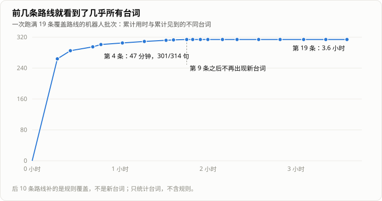

> 「HeirCut 开发手记」第八篇。游戏简介见[第一篇]()文末。

《宫廷理发师》有三天、九组客人、五个结局。换词让剧情不断分叉：第一天国王怎么选，会影响第二天公主想不想逃；第三天的二公主，要用第一天从公主那里收来的词。

这意味着改一处内容，可能在两天之后的某个结局上出问题。靠人从头玩一遍，一个结局就要很久，五个结局、每条分支都走到，几乎不可能每次改动都做。

在做自动化之前，每次发布前全靠手动测：我先尽量把每个结局都通关一遍，确认能正常走完，再把最新版本发到开发群里，团队里的其他人也会主动去玩、去找问题。

我们最后用了两样东西：一个在纯逻辑层把整局穷举一遍的**推演器**，和一个在真实场景里从新游戏玩到结局的**机器人**。前者回答「哪些内容理论上能到达」，后者回答「玩家真的能玩到」。

## 推演器：在纯逻辑层把整局穷举一遍

这件事能做，是因为剧情已经[变成了纯逻辑]()：推进一组客人，就是不断给会话发命令。推演器直接用游戏里的同一套会话逻辑，不需要 Unity。

### 怎么穷举

推演器按天、按客人组往前走。在一组客人内部：

- **状态**由两部分组成：会话的快照（在哪个阶段、哪段演出、哪些事实），加上玩家手里的东西（收集了哪些词、哪些词打过勾、手里和给出去的道具）。
- **每一步**，列出当前阶段能被接受的所有命令：推进对话、把每个合法的词换进每个槽（外加一个「不会被接住的错词」）、递每一件道具、点每个热点、理发成功或失败、摇铃。
- **相同的状态只走一次**。一组客人结束时，按「玩家手里的东西」归并，同样的结果只保留最短的那条路，作为下一组的起点。

整局穷举下来大约一分钟。

### 它告诉我们什么

- **五个结局是否都能到达**，以及每个结局最短的一条路线；
- **哪些台词、哪些规则永远到不了**；
- **一组覆盖路线**：每一轮选出「能新覆盖最多台词和规则」的一整局，重复到再也没有新增为止。

最近一次的结果是：316 句台词里 303 句可达，113 条规则全部可达，18 条路线就能把它们全部覆盖。到不了的 13 句都是需求分析失败时的反馈：其中 11 句在会话之外播放，推演器本来就看不到，机器人在实机里都见到了；另外 2 句在教程里，按设计就不会出现。

有一个细节值得记一笔：**有台词到不了时，推演器的退出码仍然是 0。** 因为「到不了」不一定是错误，可能是故意的教程分支。所以每次跑完都要拿新的清单和上一次的比，而不是只看它有没有报错。

推演器也有一个建模上的简化：一句台词里所有能剪的词，它都当作被收集了。这样「收集了哪些词」总是一个超集，覆盖范围只会被高估、不会被低估——但这也意味着它不能回答「玩家漏剪了一个词会怎样」。

## 机器人：在真实场景里玩到结局

推演器跑在逻辑层，看不见界面：词有没有显示出来、按钮被没被挡住、动画有没有卡住。这些只能在真实的游戏里验证。

机器人就是一个在 Unity 里玩游戏的脚本。它的原则是**走玩家走的路**：

- 点击和拖拽都走真实的界面射线检测。被遮住、没激活的东西，它和玩家一样点不到。
- 推演器给出的路线**只提供选择**：换哪个词、递哪件道具、理发成功还是失败。收集词、推进对话、翻笔记本、摇铃，都是它看着画面做出的反应。
- 每一步之间隔一小段时间。连续 90 秒没有任何进展，就判失败，并把当时的现场状态一起记下来。

除了走到结局，它沿路还要做两件核对：

- **台词对账**：推演器预计这条路线会出现的台词，是否全部出现了。
- **归档核对**：每收集一个词，检查它是否进了正确的笔记本页。这条核对**刻意没有用游戏里决定归档的那个函数**——用同一个函数去检查它自己，两者一起错的时候，它也会说「对」。

跑之前，机器人会把玩家的存档挪到一边，跑完再放回去。

验收分成四类：五个结局各走一遍；覆盖路线全部走一遍；九组客人各自中途存档、退出、继续，核对回到的是不是同一句；笔记本回溯（包括跨天）之后重玩。

### 成本很不均匀

覆盖路线的收益极不均匀。前 4 条大约 47 分钟，就能覆盖 93% 的内容；剩下的十几条，每条只补几句台词或几条规则，全部跑完要三个半小时左右。

所以日常只跑前几条，大改之后才跑全量；全量跑的时候也可以随时让它「跑完当前这一局就停」。

## 它们抓到了什么

自动化最直接的好处是省时间：批次排好就可以完全放着不管，回来看报告。而它抓到的，往往是人工测试很难碰到的问题：

- **台词变透明。** 卷轴「收起」的动画还没播完，下一句的「展开」就开始了，两段动画互相打架，结果卷轴处于「显示中」，却是完全透明的。只有在打开「跳过理发」、并且走到某一组客人的某一句时才必现，人工几乎不可能碰到。
- **词被放回了一页不存在的笔记本。** 第三天的二公主要复用第一天公主的需求词；把词从合成板撤回时，代码按「当天 + 当前客人」算页，算出了一页根本不存在的「第三天公主」。这是归档核对加上之后，第一次跑覆盖路线就抓到的。之前从没红过，是因为最常跑的那条路线正好不经过这段复用。
- **失败的理发播到一半时存档，读不回来。** 这是编辑器试玩后端的随机自测撞出来的：随机玩几百局，在各种时刻存档再恢复。
- **一批永远到不了的内容。** 推演器列出的「到不了」的台词和规则，拿去和策划逐条确认，删掉了几条早就作废的线索链和几句废弃台词，台词从 322 句减到 316 句，规则从 127 条减到 123 条，剩下的全部可达。之后内容又有调整，现在是 113 条规则，同样全部可达。

## 两个工具互相纠错

推演器和机器人对游戏各有一套理解，它们不一致的地方，往往就是问题所在——有时是游戏的问题，有时是工具自己的问题。

**推演器排出了玩家走不通的路线。** 会话只按规则匹配命令，而「这个槽、这句台词现在在不在屏幕上」，是游戏里的桥在把关。推演器一开始没模拟这一层，于是排出了「去换一个根本没显示出来的槽」「新的一句还没答完就摇铃」这样的路线，机器人一跑就卡住。之后推演器补上了这些界面层的条件。

**推演器把能到的内容判成了到不了。** 它要求「某条规则点名的那个词，必须是一个会打勾的候选」，可游戏里的桥只按「槽 + 词」来匹配，和打不打勾无关。修正之前，有 9 条规则、22 句台词被误判为不可达。

推演器说「到得了」，和玩家「玩得到」，原本应该是同一件事。每次两边对不上，我们都要先问清楚：错的是游戏，还是工具对游戏的理解。

## 机器人自己踩的坑

- **编辑器失去焦点时，Unity 不会正常推进。** 同一份代码，一次在主菜单卡住、一次在第三天递道具时卡住，保持编辑器在前台就全部通过。这类失败看起来非常像游戏缺陷。
- **有人按了 Esc。** 按 Esc 会打开暂停菜单，机器人卡在某一组客人的理发上，这个「卡住」被当成偶发的游戏缺陷跟了一整天。现在机器人只要看到不是自己打开的菜单，就当场判失败，并写明原因。
- **探针把游戏弄坏了。** 为了观察状态，写了一个每帧读取管理器单例的探针。场景还没加载完时，读单例会新建一个空实例，真正的实例随后被销毁，机器人在第一天结束时报错。第一次失败的原因，是我们自己加的探针。之后编辑器工具里观察状态，一律用「查找已存在的对象」，不碰单例。

## 还没解决的

- **机器人不看画面。** 它能确认流程走得通、台词都出现了，但看不出「这里的动画很别扭」「这个按钮太难找」。
- **理发是跳过的。** 要高分时，机器人打开「跳过理发」的辅助开关，所以剪发本身的手感不在它的验证范围内。
- **全量覆盖太贵**，不能每次改动都跑。

## 回头看

- **整局验证能做，是因为剧情是数据。** 推演器直接复用游戏的会话逻辑，这件事在状态机时代做不到。
- **两层验证要回答两个不同的问题。** 推演器回答「理论上能不能到」，机器人回答「玩家能不能玩到」；两者的分歧本身就是信息。
- **检查不要用被检查的东西去检查。** 归档核对如果用了决定归档的那个函数，它永远会同意。
- **自动化的失败，先排除自动化本身。** 失焦、外部按键、自己的探针——这些都长得很像游戏缺陷。
