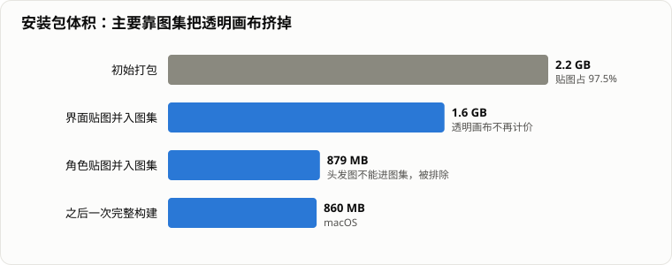
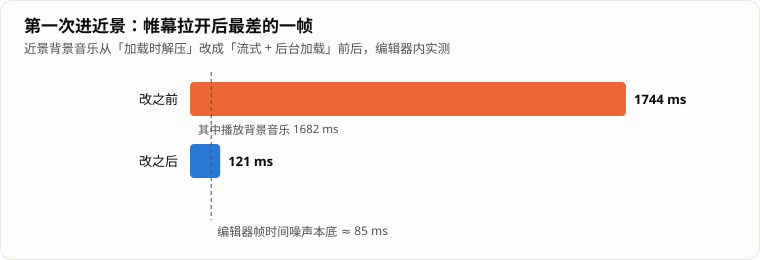

> 「HeirCut 开发手记」第十篇。游戏简介见[第一篇]()文末。

《宫廷理发师》是一个 2D 游戏，九组客人、三天剧情，安装包却一度有 **2.2 GB**。另一个问题是：几乎每次第一次进入理发的近景场景，画面都会明显卡一下。

这两件事是在重构期间集中处理的。回头看，它们的共同点是：**第一眼以为的原因，都不是真正的原因。**

## 2.2 GB 里有什么

先看构建报告：2.2 GB 里，贴图占了 2.0 GB，也就是 **97.5%**，其余都是零头。

第一反应是「导入设置没调好」：有人忘了开压缩、最大尺寸给得太大。这些问题确实存在，但量下来，大头不在这里，而在**素材的形态**上。

我们的美术习惯把每个元素都导出在一整幅 2400 × 1350 的画布上：一条装饰、一个按钮、一个对话框角，都在各自的画布上占一小块，其余全是透明。这样做有它的道理——丢进场景里，位置自动就对上了。可贴图是按画布大小计价的，**透明像素照样收全费**。

最极端的例子：一张「白条」主体只有 203 × 25，占画布的 0.2%，在包里却有 2.3 MB。整个项目有 643 张贴图整整齐齐地落在 2 到 4 MB 之间，加起来 1.6 GB，占了贴图总量的八成。

这也说明了为什么「把最大尺寸调小」不是办法：主体只占画布的 0.2%，压缩画布，就是在压缩主体。

## 用图集把透明的部分挤掉

真正对症的是 **Sprite Atlas**：它按每个 sprite 实际用到的矩形重新打包，而只被图集引用的源图不会再单独进包。屏幕上的位置和像素都不变，美术不用重新导出，场景也不用改。

第一轮先做界面：包从 2.2 GB 降到 1.6 GB。第二轮把角色贴图也并进来，降到 **879 MB**。之后一次完整的 macOS 构建是 860 MB 左右。

几个过程里踩到的点：

- **成员名单要取自真实的构建报告，而不是扫目录。** 扫目录会把一些当前根本没进包的死素材，经由图集「拽」进包里，越减越肥。后来试过按目录推断「新素材该不该进图集」，实测有 95 张反例。所以名单的真源只能是一次真实构建的报告。
- **有些图不能进图集。** 头发的网格是根据 sprite 原图的坐标算 UV 的（见[第二篇]()），进了图集就会拿到图集坐标，所以 25 张头发图（70 MB）被排除在外。被材质直接引用的贴图也不行：材质引用的是贴图本身，图集替换不了，结果源图和图集各进一份包，反而更大。
- **紧凑打包会画出邻居。** 第一轮开了按透明边缘紧凑打包的选项，结果「是否开始新游戏？」的确认面板后面多出了一个红色的「女巫」——那是图集里邻座 sprite 的像素。界面上的 Image 画的是 sprite 的完整矩形，而紧凑打包会让矩形压到邻居身上。改回按矩形打包，代价是多了 16 MB，但相比原来仍然省了六百多兆。这个选项是第一轮顺手加上的，加的时候没有验证过它到底省了多少——实测下来，几乎所有收益都和它无关。
- **一个被禁用的对象也会进包。** 开场场景里有一个禁用了的 Spine 动画对象，它照样把整套 Spine 图集打进了包。

## 压缩为什么没生效

图集之外，还有 29 张贴图一直是未压缩的。看起来是有人忘了勾压缩，其实不是：GPU 的块压缩要求宽和高都是 4 的倍数，这些图按最大 2048 缩放之后，落在 2048 × 2038、2048 × 1153 这样的尺寸上，压不了，Unity 也不报错，静默退回未压缩的格式。

更隐蔽的是验证环节：我们写了个工具比较压缩前后的像素，结果完全相同——因为压缩根本没发生，比的是同一张图（这个坑在[第九篇]()里也写了）。

这批图唯一两全的办法，是让美术按 4 的倍数重新导出，这件事还没有做。

## 第一次进近景，卡一秒七

另一个问题是：几乎每次第一次进入理发的近景场景，画面都会卡一下。听上去就是个「场景加载慢」的问题。

但优化场景加载是条死路。场景切换时，加载这整段都发生在**帷幕关上**的时候，而且只有零点几秒——就算优化到零，玩家看到的也只是帷幕少关一会儿。真正被看见的卡顿，在帷幕**拉开之后**。

定位分了三步，每一步都只是加计时日志：

1. **按阶段拆。** 帷幕关闭、场景加载、等待稳定，各自计时；再量帷幕拉开后 90 帧里最差的一帧。**跑两次**——只有第一次慢的东西，第二次会塌下去，这样才能区分「这段本来就慢」和「这段只有第一次慢」。
2. **最差的一帧落在帷幕拉开后的第 0 帧，就把那一帧里的每个调用单独计时。** 打开帷幕的调用 1 毫秒、显示工具 1 毫秒，**播放背景音乐 1.682 秒**。
3. **拿到调用名，再去查它的资源。** 三首背景音乐的导入设置都是「加载时解压」、不预加载、不后台加载，而近景这首是一轨 41.5 MB 的 Vorbis。第一次播放时，Unity 就在主线程上把整轨解压成 PCM，之后常驻内存——所以只有第一次卡。

改成**流式播放 + 后台加载**之后，这个调用从 1.682 秒降到 0.002 秒，帷幕拉开后的最差帧从 1744 毫秒降到 121 毫秒。编辑器里帧时间的噪声本底大约 85 毫秒，已经贴着本底了。三轨背景音乐常驻的 PCM 接近 100 MB，也一并省了下来。

还有一个小插曲：按文件名找这首音乐时，项目里有两首同样 41.5 MB 的曲子，名字也很像。真正被引用的那首，是按资源的唯一标识反查出来的，另一首只被一个禁用的音源引用着。**查资源按标识反查，不按名字猜。**

## 让它们别再回来

上面这些都是逐个资源修好的。可问题是：下一次美术交来新素材，它们会带着 Unity 的默认设置进来——未压缩、加载时解压——一切又回到原点。

所以加了两道守卫：

- **预防**：项目里的第一个导入后处理脚本。它只管**新素材**：新贴图默认最大 2048 并开压缩；超过 10 MB 的新音频默认流式播放、后台加载；导入后的尺寸不是 4 的倍数时打一条警告（这时拿到的是缩放后的真实尺寸，是测量，不是推算）。已有资源和手工调过的设置一概不碰。
- **检测**：三条测试——图集名单里的每一项都还存在、图集内容和名单一致、超过 10 MB 的音频必须是流式的。每一条都先做过反向检查：故意改坏，确认它会变红。第三条加上的当天，就抓出了另一首 39 MB 的音乐还是「加载时解压」。

只有一件事没法自动守住：**新素材该不该进图集。** 上面说过，按目录推断有 95 张反例。这只能作为流程要求：加了会进包的新图之后，出一次构建，拿报告和名单对比，再手工补进名单。

## 几个代码层面的小优化

体积之外，还有几处运行时的性能问题，规模都不大，但定位方式很有代表性：

- **规则求值每条都克隆一遍世界事实。** 会话对外暴露的「世界事实」每次读取都会返回一份拷贝，而判断当前有哪些规则可用时，这个读取写在了逐条遍历里——每条规则都克隆一遍整本事实字典。这个查询一帧会被问好几次，快进时还要再乘上去。改成交出一个只读的视图，拷贝只留给真正需要快照的地方。
- **快进比连按空格还慢。** 有两个都说得通的解释：一是每句的淡入动画拖住了节奏，二是推进流程里每一步都要等一帧。两个修法互斥，所以先加探针测：107 帧全部耗在淡入上，第二个解释当场被否掉。原因是快进为了跳过打字机效果，走了一条带 0.5 秒淡入的路径，上限就是每秒两句。改成「像玩家点击那样」：让这一句正常开始，然后当场显完。同一段实测从 492 毫秒降到 12 毫秒，快了大约 40 倍。
- 剪发本身的性能（节流、分批、碎片预算）在[第二篇]()里写过，这里不再重复。

## 还没解决的

- **那 29 张尺寸不是 4 的倍数的图**，还要等美术重新导出。
- **仓库本身没有变小。** 我们把一批音效演示视频移出了项目，工作区少了 205 MB，但它们早已在提交历史里，仓库的 `.git` 还是 2.1 GB。真正回收要改写历史，会让所有已有的克隆失效，这是另一个量级的决定，没有做。
- **没有设定性能预算**，也没有在目标机器上系统地做过性能测试，目前都是「发现卡顿 → 定位 → 修掉」。

## 回头看

- **先量，再改。** 包体问题的大头是透明画布，卡顿的根源是一轨音频解压，两者都不是第一眼猜的那个原因。
- **按「玩家看到了什么」来拆。** 场景加载发生在帷幕后面，再慢玩家也看不见；真正要优化的是帷幕拉开后的那一帧。
- **跑两次。** 一次性的成本，只有对比第二次才看得出来。
- **修好的东西要有人看着。** 逐个资源修好只解决了这一次，导入守卫和测试才让它们不会随着下一批素材回来。
