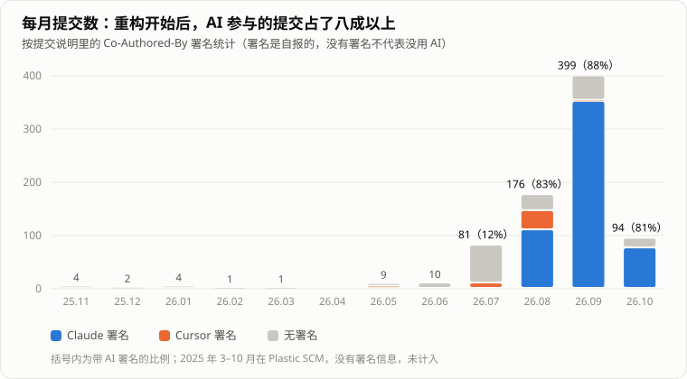

> 「HeirCut 开发手记」第十一篇。游戏简介见[第一篇]()文末。

前面十篇里，有一件事一直没讲：这个项目的后半程，绝大部分代码不是我手写的。

《宫廷理发师》从立项起就有 AI 参与，只是参与的方式一直在变：一开始是在网页上和它聊天、把代码复制粘贴回来；到现在，是由能自己读代码、跑测试、写提交的编程助手来实现，我负责定方向、看方案、做验收。这篇想如实记录这一路的变化，算是一次经验分享。

## 一开始：聊天，然后复制粘贴

项目刚开始的时候，还没有成熟的「编程助手」。我用的是 Grok、Gemini 这类对话式的 AI，主要做三件事：技术选型、看报错日志、在具体功能卡住的时候帮忙调试。

剪发用到的两个最关键的库——做多边形布尔运算的 Clipper2 和做三角化的 Poly2Tri——就是当时 Grok 推荐的（剪发的实现见[第二篇]()）。但写代码这件事本身，主要还是我自己来，AI 能帮的只是一段一段地给建议，我再搬回编辑器里。

那时最大的失望，是在**探索阶段**。剪发效果怎么做、换词这套机制怎么实现，这些从零开始摸方向的时候，AI 给的帮助很有限：它能把一个已知的方案讲清楚，但没法替我找到「头发应该当成纸来剪」这样的方向。方向定下来之后，它的作用才大起来。

## 转折：编程助手

真正的变化，是编程助手成熟之后。下面是仓库里每个月的提交数，按提交说明里的 AI 署名分了颜色：

几件事可以从这张图上看出来：

- 带 Claude 署名的第一个提交，出现在剧情系统重构开始的那一周。之后三个月，每个月都有八成以上的提交带 AI 署名。
- 提交数本身也变了：重构前每个月是个位数到几十个，重构期间一个月接近四百个。不只是「AI 替我写」，而是同样的时间里，能做的事多了很多。
- 署名是提交时自己写上的，没有署名不代表没用 AI，这张图只能看个大概。

到现在，我基本不再手写代码，连代码审阅，AI 也比我快、比我准。

## 文档把一个通用助手，变成这个项目的助手

用编程助手做一个真实项目，最先遇到的问题是：它每次都是从零开始的。它不知道这个项目的约定，不知道哪些坑已经踩过，也不知道上一次会话做到了哪里。

我的做法是让项目里多了很多文档：

- **约定工作流的文档**：分支怎么开、什么时候能提交、什么事必须先问我；
- **记录反复犯过的错的文档**：每一条都写明是哪天踩的、当时发生了什么、以后的判据是什么；
- **阶段规划和进度文档**：比如[第三篇]()里的重构计划，以及每个阶段的实施记录；
- **项目知识库**：给策划和后来的人看的指南，助手也能读。

其中第二类最有意思。比如这样一条：

> 蜡烛不再代表玩家生命……「蜡烛耗尽结局」不可抵达……这个错误已经犯了三次，三次都是「查到能支持当前结论的那一处就停下」。

它记的不是知识，而是**一种会反复出现的错误的形状**。下一次会话读到它，就知道看到蜡烛相关的代码要先回来读这一段。

这些文档合在一起，相当于为这个项目定制了一个助手。很多约束我不必每次重复，它在实施的时候就清楚边界在哪里。

不过文档也会越写越长。项目的规则文件后来长到了八百行，每一条都有来历，但规则越多，每一条被遵守的概率就越低，重要的那几条反而被淹没了。后来我把它拆成了一份一百来行的核心规则，每条只留一句话和判据；经过和细节按主题放进单独的笔记，用到时再读。

## 我现在怎么和它分工

这套做法一开始是一条条踩坑攒出来的。写这个系列的时候，我对照了 Anthropic、OpenAI 的官方建议和几位开发者的实践，把它整理了一遍，补上了几处缺口。现在一个任务大致是这样走的。

### 先定「什么算完成」

开工前先写下完成标准：一个看得见的条件，比如某个测试通过、某个命令输出某个结果、游戏里出现某个表现。写不出来，说明需求还没想清楚。

策划和美术的需求往往是一句话、一张图。我先把它梳理成有规则的描述，其实就是在找这个完成标准。

### 按大小选流程

- **一句话说得清的改动**：直接做，做完验证。
- **一个功能**：助手先读相关的代码和测试，说一下打算怎么做，再动手。
- **跨模块的大改动**，比如剧情系统重构，要先出方案：
  1. 让 AI 调查整个项目，画出数据流、状态图、模块关系。这些图本身就能说明「为什么必须重构」。
  2. 我讲清楚现在的痛点：问题由什么设计导致、当初为什么这样设计、它和哪些模块相互影响；再描述我希望重构后的样子。
  3. 它先去找成熟的做法，而不是自己发明。
  4. 写成方案文档，分阶段，每个阶段结束时项目都能构建、能运行，并且有自己的完成标准。
  5. **让它质疑这个方案**：最弱的假设是什么、可能错在哪里、出了问题怎么退回。有些方案我自己觉得好，并不一定真的好。
  6. 我拍板，然后开一个新会话，从方案文档开始实施。

方案写成文件而不是留在对话里，是为了让实施的会话只装着方案和代码。上下文越干净，它越不容易跑偏。

### 实施：一次只做一件事

一个会话只做一件事；大范围的搜索和独立的排查，交给子代理去做。

同一个问题纠正了两次还不对，我就不再追着改了，而是让它总结学到了什么，开一个新会话重来。上下文里堆满失败的尝试，只会越改越偏。

### 验证：「完成了」要有证据

对照完成标准，逐条给出命令和输出，而不是一句「完成了」。其中几条要求是踩坑换来的：新写的检查要先故意改坏、确认它会变红；失败项按名字和基线比，而不是只看总数；跑完之后，工作区要和跑之前一样。

最常用的那部分检查，现在由钩子在助手结束之前自动跑一遍，不过就不能收工。必须每次都成立的事，写成规则不如写成程序。

### 审查：换一个没看过过程的上下文

写代码的那个上下文，天然偏向自己的思路。所以交付之前，我会让一个新的上下文只看改动和完成标准，并且只报正确性问题；不报风格，否则代码会为了回应意见越改越复杂。

重要的验收也是这样：让另一个助手从头再做一遍，明确要求它**不采信**前一个的记录。审查的结论我也会逐条核对，审查者一样会错。

### 讲解：能交付，也要讲得清

我现在几乎不手写代码，这是我最担心的地方：东西能交付，我却不一定讲得清。

所以一次改动的最后一步，是让它按执行顺序带我读一遍：入口在哪、在哪里做了判断、为什么这样设计、什么情况下会坏。最核心的部分，我会自己先写，它只给提示和审查。

### 收尾：交接，以及把错误变成规则

会话结束时工作还没做完，就写一份交接文档：现在是什么状态、做了什么、**为什么这样决定**、下一步做什么、踩过哪些坑、现场留下了什么。下一个会话从这份文档开始，不需要上一段对话的上下文。

同一个错误犯了两次，就做一次复盘。复盘找的是错误的形状，而不是这一次的细节；然后给它找一个最强的落点：能用钩子或测试强制的，就强制；只属于这个项目的，写进踩坑记录；只有那些会静默失败、又经常遇到的，才在规则文件里留一句话。

## 它会犯什么样的错

和 AI 一起工作，产出的速度上去了，出错的速度也上去了。项目的文档里记了不少它犯过的错，回头看，最典型的有这几种：

- **找到第一个能支持结论的证据就停下。** 蜡烛那条就是。看到一个开关叫「生命惩罚已关闭」，就推断「蜡烛数不会变」，却没再往下读一行：熄灭动画的函数第一行就因为同一个开关直接返回了。于是它写出了一份让人去看「蜡烛熄灭动画」的验收清单——一个根本不会发生的画面。
- **统计口径本身就是错的。** 为了统计一个文件里两部分代码各引用了多少旧单例，用「第一个内部类的行号」来切分。可 C# 允许在内部类之后继续写外部类的成员，这个文件恰好如此。错误的口径连用了六轮，每轮都报告「某某已归零」。
- **检查是绿的，但验的不是那样东西。** [第九篇]()里的大部分坑，都是在这种协作中踩到的：只认成功信号的监视脚本、按目录整文件覆盖时悄悄丢掉的 250 行、为了观察状态反而把游戏弄坏的探针。

应对的办法，说到底都是**把验证变成显式的**：

- 每一个错误的形状，都写进文档，附上日期和以后的判据；
- 新写的检查，先故意把被测的东西改坏，确认它会变红，再相信它的绿；
- 提交说明里明确写「未验证」的部分：哪些在 Unity 里跑过，哪些只是离线编译通过；
- 重要的验收让另一个助手从头再做一遍，并且明确要求它**不采信**前一个的记录。

## 最大的收获

最让我惊喜的，是经过持续的努力，在助手的辅助下完成了剧情系统的绝大部分重构。

这件事的意义不只在代码本身。重构之后，才有了策划自己能用的[编辑器]()、才能[存档到对话中的某一句]()、才能让机器把整局玩一遍。团队原本「策划写表格、我照着改代码」那种并不健康的工作流，也随之改变了。

## 还没做好的

- **工作流刚整理成形。** 上面这套是写这个系列时才整理出来的，还要在下一个项目里检验，看哪些规则真的起作用、哪些只是看起来有用。
- **探索期还是得靠人。** 从零找方向的时候，助手的帮助依然有限。
- **验证的成本没有消失，只是换了位置。** 写代码的时间少了，看方案、定判据、确认它真的验了该验的东西，花的时间多了。

## 回头看

- **AI 的角色，是跟着工具一起变的。** 从聊天窗口里的顾问，到能自己动手的助手，我的工作也从「写代码」变成了「定方向、看方案、做验收」。
- **让它了解这个项目，比让它更聪明更重要。** 一份写清楚了约定、错误和判据的文档，比每次在对话里重复叮嘱有用得多。
- **先说清什么算完成。** 完成标准写不出来的任务，验证也无从谈起。
- **让它质疑我。** 我觉得好的方案，并不一定就是好的。
- **它跑得越快，验证越要写在明处。** 速度放大的不只是产出，也放大了「以为验过了」的错觉。

这是这一批的最后一篇。十一篇写下来，大部分都在讲做错了什么、后来怎么改的。这大概也是做这个项目这一年，最真实的样子。
