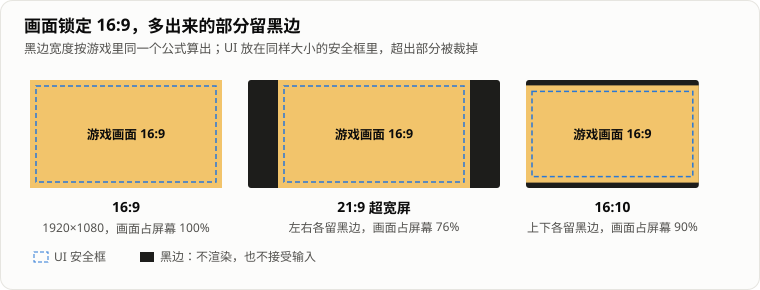

> 「HeirCut 开发手记」第十二篇。游戏简介见[第一篇]()文末。

《宫廷理发师》很长一段时间只在 16:9 的屏幕上表现正常，在不是 16:9 的显示器上全屏玩，经常出各种问题。我们的应对办法是：每次发版，除了全屏版，再另出一个窗口版，遇到问题的人就用窗口玩。

这样能凑合，但很繁琐，而且窗口版谈不上沉浸。今年七月，在一次比赛提交之前，我们终于把它做成了自适应：任何屏幕都能全屏玩。

## 为什么非 16:9 会出问题

这个游戏的画面是一张张摆好的 2D 构图。[第十篇]()里提过，美术习惯把每个元素都导出在一整幅 16:9 的画布上，丢进场景位置就是对的。客人站在哪、帷幕拉到哪、笔记本从哪里滑出来，全都是按 16:9 的画面摆的。

屏幕比例一变，这套按 16:9 摆好的构图就失去了前提，问题也就五花八门。

## 选择：画面锁定 16:9，多出来的留黑边

常见的做法有几种：拉伸（画面变形）、把视野放大（要给画布以外补美术）、裁掉一部分（会丢掉构图里的内容）。对一个每一处都按 16:9 手摆的 2D 游戏来说，最稳妥的是**不改变画面本身**：画面始终是 16:9，屏幕更宽就左右留黑边，更高就上下留黑边。



计算本身很简单，以 1920 × 1080 为参考，算出画面在屏幕上应该占的矩形：

```csharp
public static Rect CalculateViewport(int screenWidth, int screenHeight)
{
    var windowAspect = (float)screenWidth / screenHeight;
    if (Mathf.Approximately(windowAspect, TargetAspect)) return new Rect(0f, 0f, 1f, 1f);

    if (windowAspect > TargetAspect)          // 屏幕更宽：左右留黑边
    {
        var width = TargetAspect / windowAspect;
        return new Rect((1f - width) * 0.5f, 0f, width, 1f);
    }

    var height = windowAspect / TargetAspect; // 屏幕更高：上下留黑边
    return new Rect(0f, (1f - height) * 0.5f, 1f, height);
}
```

然后把这个矩形设给场景里的每一台相机。黑边本身由一台专门的相机负责：它什么都不渲染，只把背景清成黑色，垫在最底下。

UI 是另一套坐标系，要单独处理。显示管理器会找出场景里需要适配的 UI 画布，逐个设成以 1920 × 1080 为参考缩放：屏幕偏宽时按高度对齐，偏高时按宽度对齐。画布里原有的元素全部挪进一个 16:9 的「安全框」，超出框的部分直接裁掉，这样 UI 和画面始终对得上。

## 真正麻烦的是输入

画面加上黑边并不难，难的是**黑边里的点击**。

这个游戏几乎所有的交互都依赖鼠标位置：用剪刀划线剪头发、把词从笔记本拖进对话、在合成台上拖需求词、染发小游戏里拖色块、光标跟随……原来这些代码都默认「整块屏幕就是画面」。加了黑边以后，鼠标完全可能落在画面之外。

所以除了显示管理器本身，还有 12 个脚本跟着改了，规则统一成一条：**落在黑边里的输入不算数。**每个交互的具体处理不一样：

- **剪刀**：划进黑边的那一段不算；在黑边里松开鼠标，这一刀按画面内划过的部分结算；
- **拖拽**：词、道具、色块被拖到黑边上松手，视为没放下，回到原处；
- 拖拽开始时就在黑边里的，直接忽略。

镜头震动也要改。它原来直接改相机的显示矩形，默认这个矩形就是整块屏幕，震动结束时把它重置回全屏。加了黑边以后，这一重置等于把黑边震没了。现在震动改成在当前画面矩形的基础上偏移，结束时也回到这个矩形。

回头看，这和我们在别处总结的一条修复准则是一回事：**给一样东西加上新规则之前，先把所有会碰到它的地方列全。**这次的「东西」是屏幕坐标，碰到它的地方散落在十几个脚本里。漏掉一个，就是黑边里一次莫名其妙的点击。

## 边上的那条缝

黑边加上之后，又冒出一个小问题：美术素材的边缘和画面边界没有严丝合缝，在黑边旁边露出一条亮线。

我们没有逐张去改素材，而是在画面四周最内侧各盖了一条细细的黑条：上下 4 像素、左右 11 像素，放在一个永远在最上层的画布上。这是在显示层打的补丁，不算优雅，但在比赛提交前能马上解决问题。

## 比赛前的取舍

整套适配做完的第二天就要出比赛提交的包，有些东西来不及做完：

- 分辨率和窗口模式本来要做成玩家可以调的设置，当时只有一个代码临时生成的面板，和菜单的美术不搭。提交版干脆把面板藏起来，默认 1920 × 1080 无边框全屏。
- 同一个提交里，顺手把剪刀轨迹的宽度从 0.03 调到了 0.06。

两周多以后，菜单美术更新，临时面板被删掉，正式的设置面板里只保留了一个开关：无边框全屏还是窗口，分辨率按模式自动选。玩家的选择会保存下来；没设置过的，默认还是 1920 × 1080 无边框全屏。

这部分代码是和 AI 编程助手一起写的。显示管理器本身很快就写出来了，真正花时间的是上面那张清单：哪些地方用到了屏幕坐标、每一处出界时应该怎么处理。

## 还没做好的

- **黑边浪费了屏幕。** 带鱼屏上画面只占 76%。要真正利用宽屏，得给画布以外补美术，或者让部分 UI 移到黑边里，这两件事都没做。
- **边缘遮挡条是补丁。** 根本的解决是让素材边缘和画面对齐。
- **没有自动化测试。** 视口的计算是纯函数，很容易测，但现在没有测试覆盖；各个脚本「出界不算数」的行为也只靠手动验证。

## 回头看

- **先确定什么不能变。** 这个游戏不能变的是 16:9 的构图，所以选择了留黑边，而不是拉伸或者扩展视野。确定了这一点，其余都是推论。
- **画面是容易的部分，输入才是。** 加黑边只要几十行代码，把所有依赖屏幕坐标的交互找全、逐个定好出界规则，才是工作量所在。
- **为截止日期做减法。** 提交前把半成品的设置面板藏起来，用固定的默认值顶上，等美术到位再并进正式面板。

不用再单独发窗口版，是这次最直接的收获。
