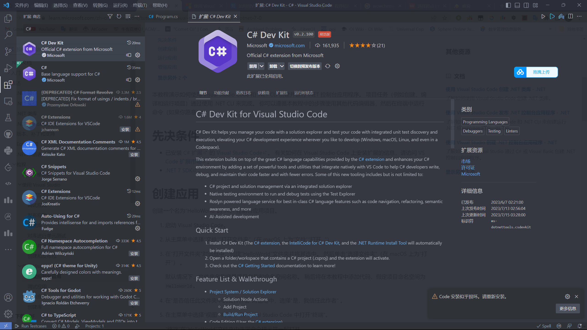
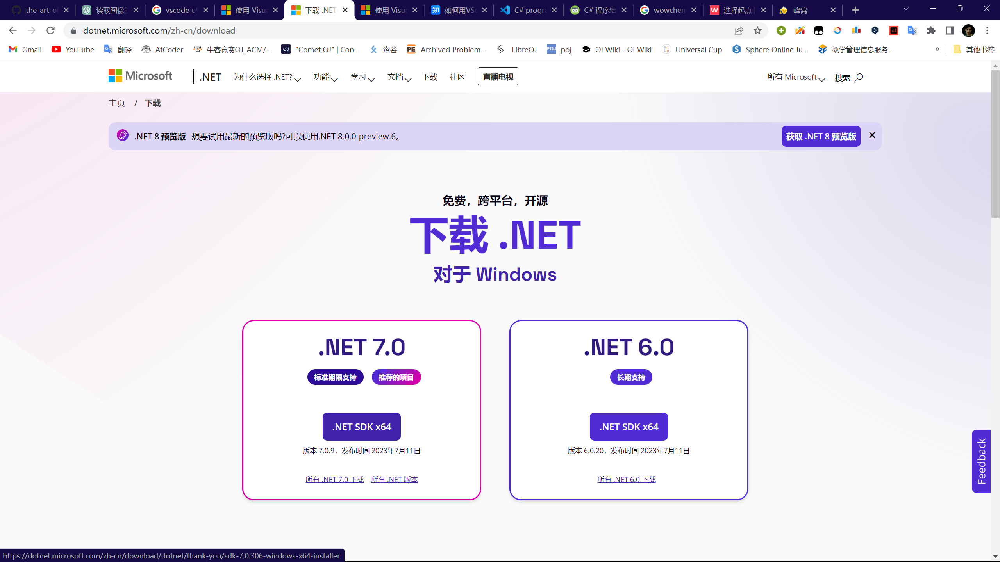

# Preparation

1. Download the C# extension

   

2. [Download NET7 SDK](https://dotnet.microsoft.com/zh-cn/download) 

   


# Create and run the app

​		***Let's take HelloWorld as an example:***

​	1. Create a HelloWorld folder or enter it in the command panel

```bash
dotnet new console -o ProjectName -f net7.0
```

​		If you entered it in the command panel, please proceed to step **3.2**

2. In VSCode, select Open **File > Open Folder**
2.  3.1 **Using the VSCode Command Panel**

> 1. Use ```Ctrl + Shift + P``` to open the command panel
> 2. Find and select ```.NET: New Project```
> 3. Next, you need to select a project template and select ```Console App```
> 4. Enter the project name and select the project path
> 5. You can see ```Program.cs``` in the project folder, and its contents are as follows:
>
> ```c#
> // See https://aka.ms/new-console-template for more information
> Console.WriteLine("Hello, World!");
> 
> ```
>
> 6. Rename file ```Program``` to ```HelloWorld.cs``` and change the content to
>
> ```c#
> namespace HelloWorld
> {
>     class Program
>     {
>         static void Main(string[] args)
>         {
>             Console.WriteLine("Hello, World!");
>         }
>     }
> }
> ```
>
> 7. When running the file, clicking ```Run code``` directly will cause an error; you should select ```Debug/Run project associated with this file```
>
> ```plaintext
> scriptcs : 无法将“scriptcs”项识别为 cmdlet、函数、脚本文件或可运行程序的名称。请检查名称的拼写，如果包括路径，请确保路径正确，然后再试一次。
> 所在位置 行:1 字符: 1
> ```

​		3.2 Using the terminal

> 1. Once the terminal has navigated to the project folder, enter it in **Shell**
>
> ```bash
> doenet new console
> ```
>
> ​	You may have noticed that it resembles the commands from the first part; actually, the first instruction completes the creation of folders and applications in one step.
>
> 2. Next, find ```Program.cs``` and make the same modifications as **in 3.1**.
> 2. When running the project, enter it in the terminal
>
> ```bash
> dotnet run
> ```

 

> Postscript:
>
> ​		To be honest, I find using VS much more convenient......
